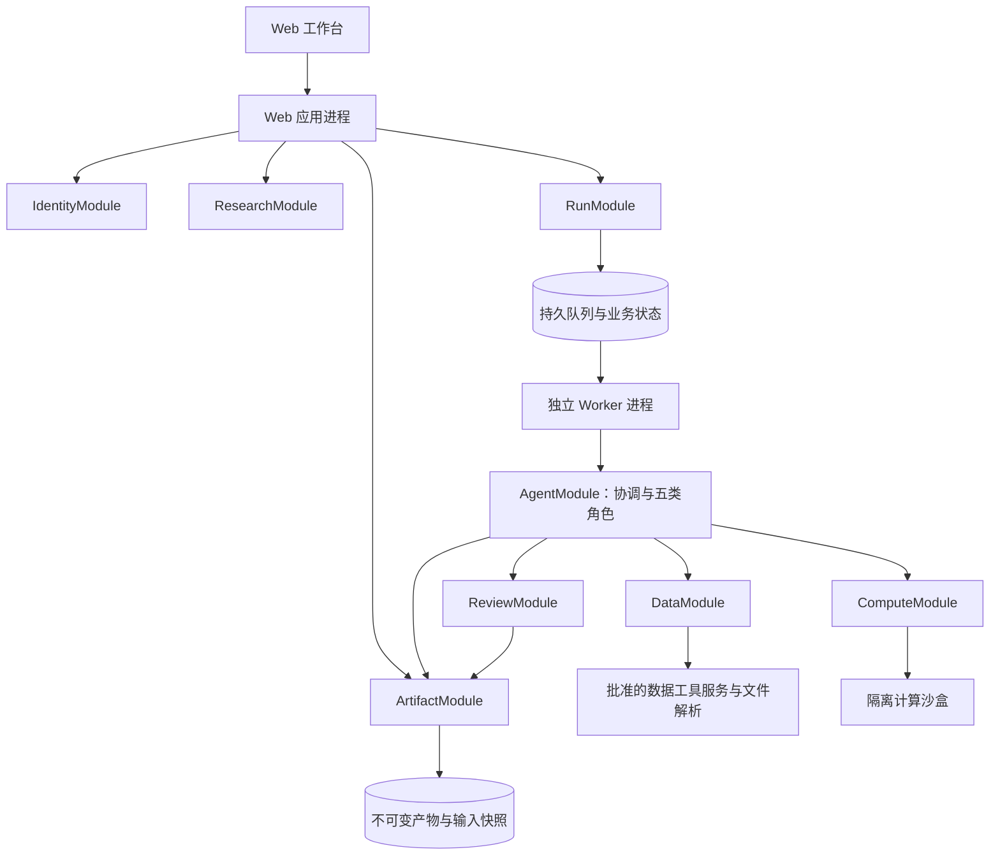
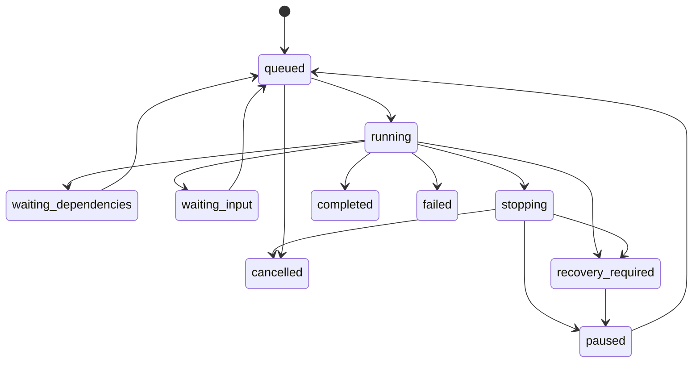

# 综合投研平台架构设计 v1

日期：2026-11-12。状态：总体架构已确认；下列模块、字段与接口是目标工程设计，尚未据此完成实现和验证。

配套：[设计入口与决策](README.md) · [产品设计](platform-product-v1.md) · [实施分期](platform-roadmap-v1.md)

## 1. 架构目标与原则

1. 以项目、任务、实验、执行与产物表达研究工作，报告是产物类型之一。
2. 一个协调 agent 按需组织五类业务 agent，角色可独立使用，角色数量不等于固定执行步骤数。
3. 模型负责目标理解、研究方法、代码生成与解释；结构校验、权限、计算、预算、状态转换和发布由程序执行。
4. 业务记录、计算回执和产物引用提供可追溯性；模型的自述和 todos 不构成执行成功或授权凭据。
5. 同一用户可以跨项目复用；用户隔离覆盖持久数据、执行上下文、检索、记忆和导出。
6. 先采用模块化单体、持久队列、独立 worker 与沙盒，不因引入多 agent 拆成多个网络微服务。
7. 保留已知有效的工具、计算与执行机制，通过明确接口解除报告专属依赖。

本文中的 Module（模块）是封装完整行为的单位，Interface（接口）同时规定输入输出、约束、错误和副作用。模块先作为同一代码库内的组织方式，不对应独立部署进程。

## 2. 当前代码基线与差距

以下是 2026-11-12 文档整理时的源码核查。核查未调用真实模型或外部数据服务；同日其他实施记录中的运行结果不视为本设计的验证结果。

| 当前事实与源码 | 平台化含义 |
| --- | --- |
| [contracts.py](../../src/research_copilot/contracts.py) 注册 `searcher/analysist/writer/reviewer`，`RunContext` 绑定 `report_id` | 增加 backtester，并把运行身份泛化到用户、项目、任务、执行；不能只添加一个 prompt |
| [autonomy.py](../../src/research_copilot/runtime/autonomy.py) 的 `ReportScope` 固定四种报告类型 | 新建研究目标与任务类型合同，报告类型只用于报告产物 |
| [subagents/services.py](../../src/research_copilot/subagents/services.py) 的正式提交主要处理 analysis/report | 数据集、模型、因子和回测需要独立登记、版本、检查和消费合同 |
| [run_queue.py](../../src/research_copilot/runtime/run_queue.py) 有持久队列和租约；[web/app.py](../../src/research_copilot/web/app.py) 在 Web lifespan 中启动 worker | 沿用持久执行思路，增加独立 worker 入口，明确 Web 与 worker 的所有权和恢复职责 |
| Web 采用启动配置中的固定 actor；[experience.py](../../src/research_copilot/runtime/experience.py) 的经验表/召回缺少完整用户所有权约束 | 需要真正的登录身份与逐链路隔离，不能只在项目列表增加筛选 |
| [financekb_contracts.py](../../src/research_copilot/sources/financekb_contracts.py) 与[合同快照](../../src/research_copilot/sources/financekb_contracts.json) 当前为六域、16 个批准工具 | FinanceKB 是可复用的首个工具服务适配器；上游已有 futures 工具不扩大本轮 A 股产品范围 |
| 行情合同标注股票不复权；财报查询无历史修订版本参数；目录未提供完整历史行业/指数成分合同 | 数据目录可用不代表满足历史回测，需数据能力检查与受限探索语义 |
| [workspace/inputs.py](../../src/research_copilot/workspace/inputs.py) 有底层导入能力，现有界面没有完整文件解析与数据预览闭环 | 文件上传、解析、映射、数据登记和检查需要产品化 |
| [财务计算脚本](../../src/research_copilot/resources/skills/analysist/financial-modeling/scripts/dcf.py)、[沙盒回执](../../src/research_copilot/sandbox/receipts.py)已有实现 | 可复用估值计算及代码/输入/环境留痕，补充任务与数据集合同 |
| [sandbox/contracts.py](../../src/research_copilot/sandbox/contracts.py) 主要描述标量指标和图表 | 因子面板、持仓、交易、模型和数据集需要扩展类型；本次核查未发现专门的因子/策略回测业务闭环 |

技术栈以当前[后端依赖](../../pyproject.toml)和[前端依赖](../../frontend/package.json)为基础：Python、FastAPI、Deep Agents/LangGraph、SQLAlchemy/PostgreSQL、React/TypeScript、Vite/ECharts 与 Docker。具体依赖版本以锁文件为准，本轮不提出版本升级或编排框架替换。

## 3. 部署与模块组织

Web 接收用户命令、展示状态与结果；worker 领取已持久化任务、驱动编排并调用计算。初始集中部署可以在单机上运行多个进程，共用 PostgreSQL 和受控文件目录。对象存储和跨机器 worker 是后续部署适配选项，不宣称已获验证。

### 3.1 模块与接口建议

接口名是语义草案，不是当前可调用接口。依赖通过装配注入；同一数据库事务可覆盖必要的跨模块登记，不引入重复的独立状态真相。

| 模块 | 面向调用方的接口形状 | 封装的复杂性与约束 |
| --- | --- | --- |
| IdentityModule | `authenticate`、`authorize` | 服务端身份、资源所有权、执行能力；客户端/模型不能指定别人的 owner |
| ResearchModule | `create_project`、`propose_task`、`revise_task`、`record_message` | 项目与对话路由、任务/实验配置版本、目标变更、旧版成果归属 |
| RunModule | `submit`、`control`、`inspect`；worker 内部领取接口 | 原子准入、幂等、租约、父子执行、预算、停止恢复、执行事实 |
| ArtifactModule | `stage`、`publish`、`resolve`、`discover` | 类型与版本、哈希、来源关系、发布事务、授权、质量记录关联与复用 |
| DataModule | `acquire`、`import_file`、`materialize` | 工具合同、文件解析、字段/时间/单位标准化、数据快照和质量画像 |
| ComputeModule | `execute`、`inspect_execution` | 代码/参数/环境冻结、计算适配器、沙盒、资源限制、计算回执和输出校验 |
| AgentModule | `coordinate`、`invoke_role` | 角色注册、上下文组织、工具装配、模型调用与结构化结果 |
| ReviewModule | `evaluate` | 按产物类型检查、冻结审核输入、质量结论、问题定位与返工建议 |

RunModule 负责派发，AgentModule 只通过授权的接口句柄提出动作和使用工具。角色不得自行创建旁路队列、提高预算或访问任意工作区。ReviewModule 同时支撑审核 agent 的自主检查和无需模型的确定性检查。

DataModule 的真实变化点是工具服务与本地文件两类输入；ComputeModule 的真实变化点是财务计算、因子计算与回测。其他暂时只有单一实现的持久化细节保持内部组织，不为假想供应商提前增加多层接口。

### 3.2 持久化职责

- PostgreSQL：账号与资源所有权、项目、消息、任务/实验版本、运行、派发、队列、预算、产物目录、检查记录、复用关系与经验索引。
- 文件存储：原始上传、原始来源响应、标准化数据、代码、模型、计算输出、图表和报告等不可变内容。
- LangGraph checkpoint：模型/工具循环恢复所需的执行上下文；业务发布是否成功仍由业务记录与回执决定。
- 查询索引与项目摘要：可重建的派生视图，必须按 owner 过滤，不成为权限或执行状态的唯一来源。

产物发布使用先持久化内容、校验哈希，再提交元数据和可见引用的方式。未完成提交的内容不可被后续任务当成正式输入。索引刷新与状态通知通过可重放的内部记录驱动，不因一次推送丢失而丢失业务状态。

## 4. 领域对象与核心约束

### 4.1 对象定义

| 对象 | 含义与建议关键字段 |
| --- | --- |
| User | 真实登录主体；`user_id`，状态与账号关联 |
| Project | 长期研究容器；`project_id`、`owner_id`、项目目标与材料索引 |
| Conversation / Message | 项目主对话；消息可显式关联 `task_id`，并保留实际引用 |
| Task / TaskRevision | 业务目标及冻结修订；`task_id`、`project_id`、目标、范围、验收条件、预期产物、研究截止时点 |
| Experiment / ExperimentRevision | 一个可比较假设及配置；所属任务、假设、因子/策略定义、样本和验证配置 |
| Run | 一次正式业务执行；`run_id`、任务修订、可选实验修订、父执行、预算账户、状态、停止原因 |
| Dispatch | Run 内一次角色派发；角色、目标、输入引用、工具能力、额度、依赖、返工关系和幂等键 |
| ExecutionAttempt | 一次具体计算尝试；代码/输入/参数/环境哈希、执行身份、状态、输出与资源用量回执 |
| Artifact / ArtifactVersion | 一个逻辑产物及不可变内容版本；类型、owner、来源 Run、内容哈希、schema、输入关系与存储定位 |
| ReviewAssessment | 对精确产物版本的检查；规则版本、检查范围、质量结论、问题、限制、检查来源 |
| SourceRecord / DatasetManifest | 来源与数据画像；取得方式、原始哈希、字段、单位、证券/期间、时间语义、转换记录与缺口 |
| MethodExperience | 同一用户可复用的方法经验；来源版本、适用条件、建议、限制、质量状态、是否停用 |

实验是可选研究对象，不是所有任务都要建立的空壳。一个 Task 可以有多个 Run；一个 Experiment 可以有多个配置修订和重跑记录。普通数据整理、写作或独立审核可直接运行而不创建实验。

### 4.2 身份与版本约束

1. 所有用户研究对象都归属一个 owner；项目内任务、执行和产物必须具有相同 owner。
2. 跨项目引用必须同 owner。公共代码与预置方法可以共用，用户私有内容及其摘要、缓存与索引不得跨 owner 复用。
3. Run 冻结业务目标修订及初始材料。执行过程中获得的新材料经登记后，在每次下游 Dispatch 准入时解析为精确版本。
4. `latest` 只能用于界面选择或发现；实际执行与检查使用 `artifact_id + version + content_hash`，不可静默追随新版本。
5. 改变目标、样本或已冻结的实验配置，创建新修订与 Run。原结果保留，不覆写历史。
6. 同一配置下的失败修复可产生新的 Dispatch、计算尝试和候选版本，但保留返工链和原预算归属。
7. 自动比较不同配置时，建立独立实验修订与执行记录，关联同一上层任务/预算；不得在一个结果记录内悄悄替换配置。
8. 暂停与恢复不重置 Run 身份、回执或已用额度。终态 Run 的重新执行产生新 Run，并保留重跑原因和原记录引用。

### 4.3 产物类型建议

| 类型 | 内容 | 核心检查 |
| --- | --- | --- |
| evidence / source_document | 原始材料、定位和来源信息 | 来源可追溯、时间与内容完整性 |
| dataset | 表格/面板数据及 schema、时间画像、转换链 | 主键/字段、单位、重复/缺失、可得时点与范围 |
| model | 公式或代码、假设、参数、输入合同、环境及计算结果引用 | 事实与预测分离、公式/口径、输入输出相容 |
| factor | 因子定义、代码、因子面板与检验结果 | 时点、样本、公式、验证窗口、缺失处理 |
| analysis | 结论、指标、图表和依据 | 数值与输入、计算回执、论证及限制 |
| backtest | 配置、净值、指标、持仓、交易、成本与日志 | 数据时点、交易规则、记账和指标一致性 |
| report / research_note | 正文、表图、引用和限制 | 数字/结论来源、覆盖要求、表达质量 |
| review | 冻结目标版本与检查结果 | 目标/规则身份完整；不递归触发另一轮审核自身 |

代码和图表可以是产物的附件，也可被登记为独立可复用版本；二者都要通过明确引用关联执行。类型扩展使用 schema 版本，不把大表格或二进制内容塞进模型上下文。

## 5. 任务编排与上下文

### 5.1 协调过程

1. 主对话定位当前用户、项目和消息所指任务，澄清会改变研究含义的必要信息。
2. 读取项目说明、相关任务摘要和该用户可访问的资产索引，按需解析精确引用。
3. 提出任务目标、交付物、约束和验收条件；服务端校验并创建 TaskRevision 与 Run。
4. 协调 agent 使用现有编排框架维护研究步骤，提出角色派发和依赖；RunModule 检查范围、版本、权限、额度和依赖是否满足。
5. 业务角色执行，提交结构化结果与候选产物；计算与来源调用另有持久回执。
6. 对交付候选执行对应检查；必要时安排有界返工。
7. 根据已登记的产物、检查与停止条件汇总，更新项目对话摘要。

计划与方法可在授权研究范围内调整。业务权限和正式执行事实来自程序保存的合同与回执，不由可变的 todos 推导。

简单任务可以直接派给指定角色，省去无必要的协调模型往返；仍经过同一准入、预算、权限、产物和检查接口。多个独立子任务可并行，依赖下游必须等候上游版本完成登记。任务依赖须无环且有规模上限；返工用新的有界尝试表达，不创建无限循环。

### 5.2 角色注册与工具能力

角色注册建议包含 `role_id`、职责说明、输入合同、可产出的类型、工具能力集、上下文策略、模型路由与运行政策。初期保留现有内部 ID `supervisor/searcher/analysist/writer/reviewer`，新增 `backtester`；产品显示使用中文职责名。历史 ID 不因拼写整理而修改。

- Searcher 使用批准的来源接口与文件解析，不持有任意执行能力。
- Analysist 使用财务/因子计算和允许的自定义代码能力。
- Backtester 使用版本化回测配置与计算接口。
- Writer 读取授权的成果与来源，产出正文和引用，不能补造计算结果。
- Reviewer 读取冻结的待查版本、输入和回执，返回检查记录，不覆盖作者版本。
- Supervisor 可以提出派单、依赖和返工，不能改变所有权、放宽权限、清零消耗或伪造审核。

数据缺失、假设、不可得结果和失败应为结构化返回，避免协调 agent 从自然语言自行猜测状态。

### 5.3 上下文组织

项目上下文包括项目说明、目标约束、任务摘要和产物索引。任务上下文包括冻结目标、精确材料、当前假设和执行进度。每次角色派发只提供其职责所需的输入与工具。

跨项目检索先在用户范围内搜索元数据与摘要，再读取相关内容；每次实际消费重新校验 owner、版本、时点、质量和适用范围。方法经验记录来源及适用条件，不能覆盖当前任务的明确要求。

项目摘要是可重建视图，不替代原始消息、证据和产物。长对话摘要、角色上下文、检索索引和源文件都要使用一致的用户身份；隔离只做到页面层不足以满足设计。

## 6. 执行状态、幂等与恢复

### 6.1 执行状态建议

| Run 状态 | 语义 |
| --- | --- |
| queued | 已完成持久准入，等待 worker |
| running | 正在推进研究或角色执行 |
| waiting_dependencies | 等待本次研究内已登记的依赖，不占用计算槽 |
| waiting_input | 需要用户决定或补充必要信息 |
| stopping | 已接收暂停/取消，正在收尾外部执行 |
| paused | 已保存可继续状态；包括用户暂停或达到运行政策上限 |
| recovery_required | 外部请求、计算或所有权状态未知，需先核实才能安全继续 |
| completed | 本次执行已交付，成果质量另行标记 |
| failed | 已确认的不可恢复失败，保留候选结果与原因 |
| cancelled | 已确认取消并完成可确认的收尾 |

图示为主要路径；每次控制操作仍要检查当前状态、所有权和状态版本。浏览器断开只断开观察，不改变 Run。任务汇总状态从其运行与交付记录推导，不再维护另一套由模型直接写入的完成状态。

### 6.2 执行一致性

- Web 接受执行请求时，原子记录 Run、幂等键与队列项。重复提交同一操作返回原身份。
- worker 通过租约取得执行权；续租与写入携带递增的所有权代次，过期 worker 的迟到写入不得覆盖新执行事实。
- 派发、模型请求、工具调用、计算和发布分别使用稳定操作身份，保留已提交回执。checkpoint 落后时先核对回执，不重复产生已确认的副作用。
- 暂停只在可确认的执行边界完成；取消已发出的外部请求可能需要收尾，无法确认的状态进入 `recovery_required`。
- 有证据表明尚未执行的队列项可以重新领取。已经发出但结果未知的付费请求或计算不能因租约过期直接自动重放。
- 用户核实恢复后先进入可继续状态，再由明确的继续操作恢复；这属于异常执行恢复，不增加日常计划批准关口。
- 同一 Run 的多个结果只有当前有效执行权能够提交；发布幂等不能被误写为外部服务保证“恰好一次”。

对上层研究执行的暂停或取消作用于该 Run 及其本次研究内的全部后代 Run。先原子记录控制意图并阻止新子执行/派发准入，已在途子执行在可确认边界收尾；已完成子执行的回执保持不变。所有相关执行确认停止后，父级才能显示 `paused` 或 `cancelled`；任一后代外部结果未知时，父级进入 `recovery_required`，不得假报已停止或完成。

恢复执行树时沿用原有非终态子 Run、派发回执和预算，只重新准入允许继续的步骤；已完成的子结果直接复用。父级最终交付前也需结清该次研究的在途与未知执行，失败或已确认取消的候选可以作为有记录的研究结果保留，不要求所有候选都成功。该控制范围不包含同一用户的其他独立任务。

### 6.3 额度与停止

运行政策包含模型调用/费用或 token、来源调用、派发、计算时间与资源、候选数量、返工次数和无进展阈值。实际数值待实施前确定，未配置有效边界的任务不得无限运行。

上层任务、子 Run 与角色共享可核对的预算关系。发出付费请求前预留，收到可靠使用记录后结算；未知用量保留待核对状态。新增任务或新派发不能抹去前次消耗，也不能自动提高额度。

达到验收要求即交付；达到探索或返工上限时保存已知结果和未决项，并区分可交付探索成果、暂停和失败。没有用户命令或本次研究内部的已授权依赖，不新建后续研究；不引入定时调度器、行情订阅触发器或公告触发的新任务。

## 7. 数据接入与快照

### 7.1 统一数据合同

工具适配器保留原始响应、来源工具与合同版本，文件适配器保留上传文件、解析器版本和映射。两类输入都生成标准化数据及 DatasetManifest。

数据画像至少包括：

- 字段类型、主键、证券标识、单位、币种、报表与行情口径。
- 样本与时间范围、行数、缺失/重复情况、数据排序与对齐规则。
- 观测期间、公开时间、可得时间、取得时间及来源修订标识；未知值显式未知。
- 复权/公司行动处理、历史股票池与行业分类的来源及适用边界。
- 清洗、合并、累计转单季、派生列等转换代码或规则版本，以及原始输入引用。
- 所有权、内容哈希、来源许可或使用约束（存在时）、质量检查与限制。

`period_end`、`published_at`、`available_at`、`retrieved_at` 等字段是不同语义。抓取日期不能替代财报公开日期；研究截止时点也不能替代回测逐日可得性检查。市场业务日期声明时区，运行日志可统一存 UTC。

### 7.2 数据准备路径

1. 根据任务的证券、期间、字段与时点要求生成数据需求。
2. 在同用户资产中发现可复用数据，检查相容性并固定版本。
3. 通过批准工具或文件解析补齐缺口，校验合同、结构与原始内容。
4. 标准化、清洗、转换并生成数据快照。
5. 输出数据质量画像、限制及检查结论，供分析或回测选择适用方式。

发现数据源可连接不代表满足具体任务；全域外部来源不可用时，仍可执行只依赖已登记资产或本地文件的任务。新平台按任务所需能力判断准入，不继续把“所有研究都需要外部来源在线”作为全局前提。

来源未知工具和语义变化须审阅后接入，不能只根据工具名称动态授予能力。现有 FinanceKB 适配器继续使用批准合同；通用数据接口不绑定它的域数或工具数。

### 7.3 回测数据缺口与探索

当前合同尚不足以证明完整的历史时点、复权、历史成分与证券存续覆盖。数据准备应逐项返回证据和缺口，具体补齐方式可能是扩展来源工具、接入其他服务或用户导入。

允许在注明实际样本、可得性与处理假设的前提下生成探索结果。例如使用用户提供的固定股票列表，结果必须明确该列表的选取方式，不能包装成已验证的历史全市场选股。

若必要输入损坏、没有计算所需字段、无法核对来源或核心计算错误，则返回需要补充或失败。允许探索不等于伪造输入、静默改换研究目标或略过计算正确性。

### 7.4 数据存储职责

平台负责研究实际消费的数据快照、转换链、用户文件和研究产物，保留足够信息复核结果。全市场历史数据仓库、实时行情分发和供应商数据治理不自动纳入本期职责。

初始实现可使用版本化 Parquet/CSV 与元数据；面板计算采用分批/分区读取，避免通过 LLM 传输整份行情。保存不可变内容不要求每次物理复制全部字节，可在同用户授权范围内按哈希复用。保留期限与回收政策待定，但不能删除仍被已交付成果引用的输入。

## 8. 计算与回测执行

### 8.1 执行合同

ComputeModule 接收版本化的 ExecutionSpec，至少包括计算类型、代码/算法版本、输入引用、参数、环境配置、输出 schema 和资源政策。发起外部执行前，先持久登记 ExecutionAttempt 身份、冻结输入与代码、额度预留及资源占用；在发起过程中保存可取得的外部执行定位信息。结束后更新该记录的状态、输出清单和回执，不能等计算完成才首次登记尝试身份。worker 失联或结果无法确认时保留未知状态及占用，交由恢复流程核实，不能直接重新计算。

输出回执应记录输入/代码/参数/环境哈希、镜像与依赖、命令、开始结束时间、退出状态、输出哈希、资源消耗、随机种子（适用时）和限制。复现说明允许声明的数值容差，不因硬件/库变化而盲目承诺字节级相同。

保留现有沙盒的受控代码执行、输入只读和输出校验思路。模型凭据与来源凭据不进入计算容器；代码只能写指定输出位置。现有资源额度不直接套到批量因子和回测，需要按代表性数据量验证后确定不同计算配置。

### 8.2 三类计算适配器

| 适配器 | 主要行为 |
| --- | --- |
| 财务计算 | 指标、增长率、估值、情景/敏感性；显式区分事实、预测和假设 |
| 因子计算 | 因子表达式/代码、横截面处理、因子面板、检验与验证窗口 |
| 日频回测 | 交易日历、信号到持仓、权重、调仓、成交/不可成交处理、成本、净值和指标 |

首个回测适配器建议以股票多头与现金组合为工程起点，杠杆、卖空及更复杂交易结构后续扩展；这不改变标准日频组合回测的产品目标。具体交易约束需要实现时核对适用规则并保存其版本，本文不硬编码易变的市场规则或费率。

回测配置必须说明：股票池及其历史形成方式、数据可得时点、信号计算时点、成交价格与时间、调仓周期、仓位与现金、交易限制、公司行动处理、费用/滑点、基准和缺失处理。未知或简化项进入结果限制。

因子计算得到的统计关系和回测交易绩效分别交付。agent 不直接生成一条无法追溯到持仓、交易或收益计算的净值曲线。回测引擎和指标计算器使用可核算的小样本建立正确性测试，再验证真实数据规模。

### 8.3 自定义扩展

模型可以生成受控代码并通过同一 ExecutionSpec 执行。自定义策略不获得任意网络、宿主文件系统或无限运行权限。UI 首期提供代码查看和下载，用户通过对话或参数要求修改；完整 Notebook 与在线代码编辑器不在首期交付范围。

## 9. 检查与发布

### 9.1 检查分层

1. **结构与身份检查**：类型/schema、owner、版本、哈希、输入、回执和必需文件。
2. **数值与数据检查**：字段/单位、时间、公式、关键数值复算、数据覆盖和交易记账一致性。
3. **研究质量检查**：目标覆盖、假设依据、论证、敏感性、样本/验证方式、结论与限制相符。
4. **表达与引用检查**：正文数字、图表、来源和限制，适用于报告及其他叙述成果。

确定性检查优先由程序完成；审核 agent 处理需要解释和判断的部分，不能用自然语言声明覆盖硬性检查失败。简单数据任务可以使用轻量检查组合，不要求每份产物都调用完整的双模型审核流程。

### 9.2 质量状态与发布规则

建议质量枚举为 `unreviewed / passed / exploratory / rejected`，与 Run 状态分开。审核绑定目标版本、完整输入清单、规则版本与实际检查范围。

- `completed + passed`：满足声明的交付及检查要求。
- `completed + exploratory`：可交付但限制尚存；后续引用、正文和导出继承限制。
- `failed + rejected`：无法得到可用交付，保留诊断材料。
- 非终态下的 `unreviewed`：可展示候选，不标为已验证成果。

检查请求返工时，协调 agent 根据问题定位修复相关步骤，保留输入与预算关系；通过后发布新版本。待发布内容变更即需要针对新版本检查，不能挪用旧版本的审核回执。

同一输入版本可以新增检查记录，但不能抹掉旧检查历史。当前使用资格从精确版本、检查规则、适用范围及最新有效评估推导。规则变化导致检查过期时给出状态，不静默改写原产物。

审核本身产生的回执执行身份和结构校验，不递归触发审核自身。最终用户人工签署不作为新平台所有任务的必经步骤；显式人工复核是任务级选择。

## 10. 用户身份与隔离

集中部署必须提供真正的登录身份和会话校验；现有固定 `RC_ACTOR_ID` 模式只能作为当前本机实现的历史事实。账号接入方式可在实施阶段选择，但不能用前端隐藏或调用方传入 owner 来代替授权。

授权在业务入口和数据读取时落实，并在后台执行中传递不可由模型修改的身份与能力。覆盖范围包括列表、搜索、原始文件、产物下载、图表、消息推送、队列控制、检查记录、checkpoint、预算与方法经验。

文件定位使用服务端生成的标识，所有路径与下载请求都经过 owner 校验。跨用户重复内容不得借助公共缓存、索引计数或推送泄露私有研究信息。系统预置代码/方法与私有研究资产在权限上明确区分。

来源凭据经适配器从受控配置取得，只给模型必要结果，不进入消息、证据或产物。上传文本、PDF 和来源响应是研究资料，不是授予新工具或改变系统执行约束的指令。

## 11. 应用接口与事件视图建议

以下路径是目标接口草案，尚未实现；身份来自登录会话。

| 接口 | 用途与约束 |
| --- | --- |
| `POST /api/projects` | 创建自己的研究项目 |
| `POST /api/projects/{id}/messages` | 发送项目消息，可指定本项目的任务目标；保留操作幂等键 |
| `GET /api/projects/{id}/workbench` | 项目、任务、产物、质量与执行摘要 |
| `POST /api/projects/{id}/tasks` | 创建有明确范围与验收条件的任务 |
| `POST /api/tasks/{id}/runs` | 按冻结修订提交执行；原子登记幂等与队列 |
| `POST /api/runs/{id}/actions` | 暂停、继续、取消、回答澄清；携带预期状态版本 |
| `GET /api/runs/{id}/events` | 授权的进度订阅，支持游标补读与重连 |
| `POST /api/imports` | 上传与解析导入，返回可预览候选和明确缺口 |
| `GET /api/artifacts/{id}/versions/{version}` | 查看精确版本、输入关系及检查；下载通过同一授权接口 |
| `GET /api/assets` | 同用户资产发现，支持项目/类型/时点/质量筛选 |

事件视图用于已有任务的进度展示，不提供事件触发新研究的产品能力。浏览器重连后先读取权威快照，再按游标补齐动态记录；不能依赖浏览器存储维持后台任务。

## 12. 旧系统演进与兼容

1. 新增平台工作流版本与项目/任务/产物模型，避免把 `report_id` 在原表中直接改名解释成项目或任务。
2. 旧报告、旧 actor 归属、旧 checkpoint、锁与回执保持原身份；保留旧反序列化和读取能力。
3. 通过只读视图接入旧成果。将旧资料用于新研究时，新建授权材料引用或导入版本，保留原来源和旧审核/签署状态，不自动授予新质量结论。
4. 迁移账户时建立明确的旧 actor 到新用户映射；归属不明的资料先保持不可见，不能全部分配给默认登录用户。
5. 旧执行原地续跑不作为新平台兼容目标。运行中旧任务应在其受支持环境收尾或归档；新平台不接管未知的旧外部执行。
6. schema、工作区和检查点的迁移仍需备份、显式步骤与回退验证，不在普通 Web 启动时自动改写。文档整理本身不执行迁移。

可以优先保留来源适配、计算脚本、沙盒、回执、预算和租约机制；需要调整的接口是用户身份、研究范围、输入授权及产物提交。新旧代码暂时共存时，通过版本路由区分，禁止同一 Run 在两套工作流中双写。

## 13. 关键风险与实施验证

| 问题 | 需要验证的行为 |
| --- | --- |
| 报告耦合残留 | 不创建 report 也能完成采集、分析、回测和审核 |
| 上下文污染 | 项目主对话与并行任务互不改写冻结目标；旧结论不会当成新事实 |
| 数据条件不足 | 区分可交付探索、需要输入和计算失败；不伪造完整历史覆盖 |
| 用户隔离遗漏 | 对搜索、文件、SSE、经验、缓存、恢复和下载做交叉用户反向验证 |
| 重启/重复请求 | 已提交结果不重复计算或发布；未知外部请求不盲目重放 |
| 预算失控 | 子执行、返工与恢复累计计费，边界由程序执行 |
| 统计与回测错误 | 小样本可复算、数据时点明确、成本/记账一致、全部候选留痕 |
| 迁移破坏历史 | 旧成果仍可按正确用户查阅，历史 ID 与证据未被重解释 |

实际验证分为确定性业务测试、数据库/沙盒集成、浏览器流程、真实数据与真实模型验收。各层证据分开记录；本次架构文档不能充当其中任何一层的通过证明。
