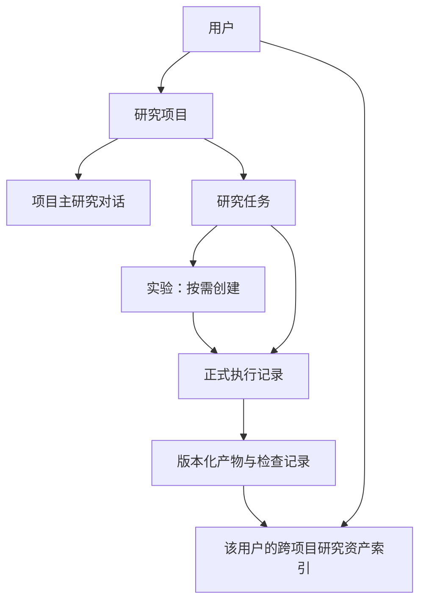

# 综合投研平台产品设计 v1

日期：2026-11-12。状态：目标基线已确认，尚未完成本设计对应的平台实施与验收。

配套：[决策与阅读入口](README.md) · [架构设计](platform-architecture-v1.md) · [实施分期](platform-roadmap-v1.md)

## 1. 产品目标

Research-Copilot 面向个人和内部小团队提供综合投研工作台。用户以研究问题发起工作，系统选择合适的 agent，自主完成采集、分析、建模、回测、撰写和检查，交付可追溯的研究成果。

首要价值是覆盖更多日常研究任务、提高自主完成程度；研究数据、代码、模型和方法经验的复用支撑这两个目标。用户可独立发起数据整理、因子研究或回测，不需要先创建报告，也不需要等待一条固定的五角色流水线。

首期研究对象为 A 股与行业，量化以日频为主。基本面与因子研究优先，机器学习建模作为后续扩展。平台交付研究成果，真实投资决策及交易执行不属于本轮范围。

## 2. 用户与使用范围

### 2.1 用户隔离

平台可以由内部多人使用，但每个用户拥有独立的项目、对话、任务、文件、产物和研究记忆。首期不提供团队共享空间、跨用户资产搜索或共同编辑任务。

同一用户可跨项目检索、引用、复制和比较研究资产。界面应显示来源项目、产物版本、产生时间、数据截止时点、质量状态和适用限制。历史结论不会因为被再次引用而自动成为当前事实。

### 2.2 范围清单

| 范围 | 内容 |
| --- | --- |
| 本轮目标 | 公司/行业研究、信息整合、数据分析、基本面建模、因子研究、标准日频组合回测、按需撰写、各类成果检查 |
| 输入 | 自然语言、参数、工具服务返回的数据、用户导入 CSV/Excel/PDF 等文件 |
| 输出 | 数据集、研究结论、分析模型、因子定义与结果、回测结果、研究备忘录/报告、检查记录 |
| 预留扩展 | 新数据服务、新业务 agent、机器学习、受控自定义策略、完整在线编程环境 |
| 本轮不纳入 | 实盘交易、定时或事件触发研究、多人共同编辑、默认跨用户共享 |

运行恢复、队列领取和内部依赖完成后的继续执行属于一个已授权任务的执行过程，不属于用户排除的定时/事件触发新研究功能。

## 3. 工作组织

- **研究项目**：长期研究主题的容器，例如“白酒行业研究”。保存目标、关注对象、项目说明和材料索引。
- **任务**：一个有明确目标、交付物与验收条件的工作单元，例如“整理三家公司的近年财务数据”。
- **实验**：需要比较或验证的研究假设及配置，例如某个因子定义与选股规则。普通资料整理和报告撰写可以没有实验。
- **执行记录**：一次正式执行的身份、输入、参数、过程、消耗、结果和停止原因。暂停后继续保留原身份；修改研究配置后重新执行形成新记录。
- **产物**：可被独立查看、引用、导出和检查的研究成果，已交付版本保持稳定。

同一任务可以有多个实验和多次执行。一个实验可以保留不同配置版本以及对应执行结果，比较时展示样本、数据、代码和参数差异，避免只比较收益或单个指标。

## 4. 工作台与交互

### 4.1 页面组织

| 页面/区域 | 主要内容与操作 |
| --- | --- |
| 项目列表 | 创建项目、查看自己的研究项目与最近任务 |
| 项目工作台 | 主研究对话、项目说明、任务列表、材料与产物入口 |
| 任务详情 | 目标、所用角色、执行进度、参数、结果、检查、用量、暂停/继续/取消 |
| 实验比较 | 选择多次执行，比较配置、样本、质量状态、指标和图表 |
| 个人研究资产 | 检索同一用户跨项目的数据、代码、模型、因子、报告和方法经验 |
| 历史成果 | 只读查看旧版报告及其证据；可按转换规则作为新任务的参考材料 |

主对话负责提出需求和统筹研究。每个任务有独立执行上下文与详情面板；项目对话引用任务摘要和产物，不承载全部工具日志和原始数据。

界面显式展示当前消息作用于“项目”还是某个任务。多个任务同时存在时，含糊的“改一下这个参数”先定位目标任务；不能把指令猜测地写入正在运行的其他任务。

### 4.2 一次任务的默认路径

1. 用户在项目中提出目标，也可以指定某个业务角色。
2. 系统识别交付物和已有材料，补问影响研究含义的必要信息。
3. 展示结构化目标、关键参数、预期产物和采用的默认值；目标清楚后自主执行，不设置例行计划批准。
4. 按需调用业务 agent，展示实际进度、正在处理的问题和已产生的候选结果。
5. 按产物类型检查，允许有界自动返工。
6. 交付成果及其质量状态、依据、参数、限制和执行记录。
7. 用户可以追问、引用到其他任务、修改参数重跑，或比较不同版本。

用户只要求解释已有成果时，可以直接在对话中答复并引用来源；新采集、计算、实验或正式研究成果必须进入可追溯的任务执行过程。对话路由本身也要遵守权限与运行额度。

### 4.3 用户干预

- 用户可查看当前计划与执行记录，暂停、取消或补充要求。
- 普通技术选择、代码修复和约束内的方法探索由系统处理。
- 改变用户指定的目标、样本范围或核心研究假设时，明确提出变更并等待用户决定。
- 参数修改不会覆盖正在执行的冻结配置；系统保留原执行，并以新配置创建后续执行。
- 暂停和取消可以需要等待当前外部调用收尾；界面显示“正在停止”及最终状态，不承诺瞬时撤回已经发出的请求。

## 5. 业务场景与交付要求

| 场景 | 典型目标 | 最低交付内容 |
| --- | --- | --- |
| 信息整合 | 汇总一个行业近期公告与重要信息 | 来源与日期、主题摘要、重复/冲突信息、缺口；可独立交付信息备忘录 |
| 数据整理与分析 | 合并企业财报或用户上传表格并解释变化 | 可下载数据集、字段与单位、清洗过程、统计/图表、缺失与异常说明 |
| 基本面研究 | 比较公司经营表现或建立估值情景 | 事实依据、预测假设、模型与参数、计算结果、敏感性和研究结论 |
| 因子研究 | 构建并检验某个日频选股因子 | 因子定义与代码、数据时点、股票池、因子值、检验结果、验证窗口与限制 |
| 策略回测 | 将信号转为选股、权重和调仓规则 | 策略配置、净值与绩效、持仓/交易、成本、基准、执行约束和数据限制 |
| 报告撰写 | 把已有研究整理为公司/行业报告 | 正文、表图、事实与结论引用、假设和限制；按需要生成完整报告或短备忘录 |
| 独立审核 | 检查某个数据集、模型、回测或报告 | 审核对象的精确版本、检查范围、问题与严重性、处理建议和质量结论 |

### 5.1 基本面建模

覆盖财务指标、盈利预测、估值、情景与敏感性分析。历史事实、预测值和研究假设分开记录；模型输出可追溯到输入及公式。公司、行业、报表期间、币种、单位、累计/单季、合并范围等口径影响比较时必须明确。

盈利预测可以由 agent 提出有依据的假设，但预测序列不能伪装为已披露事实。已有 DCF 等计算脚本只是计算基础，平台仍需要补齐假设构建、输入组织与交付流程。

### 5.2 因子与策略

因子研究和策略回测是两个可独立调用的能力。因子值与检验结果可以直接交付，也可以继续交给回测 agent，转为选股、权重、调仓及成本规则。

系统可在用户指定目标内提出多个候选策略，保留全部候选及选择依据。因子定义、计算窗口、数据可得时点、股票池、基准、交易时点和成本等进入显式配置。参数搜索要区分探索窗口与验证窗口，不能只保留最优的一次运行。

标准日频回测先支持可复现的组合规则；自定义策略走受控执行接口。具体交易规则、默认参数和计算库在实施阶段验证与版本化，本设计不宣称现有数据已经覆盖所有回测条件。

## 6. agent 协作方式

| 角色 | 负责 | 不自行决定的事项 |
| --- | --- | --- |
| 研究协调 agent | 目标澄清、拆解、选择角色、跟踪依赖、汇总、安排返工 | 用户权限、突破预算、擅自改变已指定的目标与样本 |
| 数据采集 agent | 获取、解析、标准化、登记来源与数据质量 | 把估计或无法取得的数据写成已知事实 |
| 分析建模 agent | 基本面分析、因子构建、模型假设与计算解释 | 绕过计算留痕、把研究结论直接当成成交或收益记录 |
| 报告撰写 agent | 基于已有材料组织文字、表图与引用 | 为补齐正文编造事实，掩盖来源产物的限制 |
| 策略回测 agent | 构建并执行回测配置，解释交易与绩效结果 | 隐去交易约束、成本、样本和数据缺口 |
| 审核检查 agent | 对精确版本做类型对应的检查，提出返工要求 | 覆盖作者成果、把未检查内容标为已验证 |

独立调用使用同一权限、执行、产物与审核体系。指定“回测 agent”可以复用已有合格数据；缺少必要材料时，由协调机制补齐依赖或提出缺口，不强制生成报告。

## 7. 完成、质量与探索性交付

执行是否结束与成果是否可信分开呈现。

| 成果状态 | 含义 | 使用方式 |
| --- | --- | --- |
| 待检查 | 候选版本已产生，检查未结束 | 用户可查看，不能显示为已验证的最终成果 |
| 通过检查 | 该版本满足本任务声明的检查要求 | 可以正式交付，并展示检查范围 |
| 探索性 | 可以用于探索，但存在影响适用范围的数据或方法限制 | 可以交付、比较和复用；限制必须随正文、图表与导出保留 |
| 未通过 | 存在计算、来源、结构或关键逻辑问题 | 保留以便诊断，进入返工或停止，不冒充可用结论 |

例如缺少历史财务修订版本时，可以产出明确标记时点局限的探索性因子结果。若价格文件损坏、收益计算错误或来源无法追溯，则不能仅加一段免责声明将错误结果变成合格探索成果。

任务允许以“已完成，成果为探索性”交付，不能把这类状态简单改成全部失败或强制等待补数据。审核检查通过不是对未来收益的承诺，也不代表数据之外的内容都经过验证。

所有正式产物有对应检查记录；例行任务无需用户逐次签署。需要判断目标变更、解决关键歧义或显式要求人工复核时，才进入等待输入。旧版报告的签署状态保留原含义，不自动映射为新平台机器检查通过。

## 8. 数据输入与研究资产

### 8.1 导入与采集

工具服务和文件导入共用来源记录、字段说明、时间与质量检查机制。用户导入表格时可查看解析预览，确认工作表、表头、日期、证券代码、单位等映射；遇到会改变研究含义的歧义才询问。

PDF 导入保存原文位置与提取结果，提取能力不足时给出明确限制。首版扫描件/OCR 的实现范围在数据导入阶段确认，不因为上传成功就宣称全部内容已正确解析。

资料中的指令性文字作为研究内容处理，不能改变系统权限或执行政策。用户看到的是可理解的导入结果、缺口和修正入口。

### 8.2 版本与复用

- 正式产物保留来源、版本、所属任务、执行记录和检查记录。
- 跨项目引用固定到具体版本；新版本出现时提示可更新，不静默替换正在运行的输入。
- 复用前检查证券、期间、样本、数据时点、质量状态与当前研究目标是否相容。
- 不覆盖已交付版本；修订产生新版本并标明与旧版本的关系。
- 方法经验按用户保存，记录适用条件、来源和限制，不把未经验证的研究结论固化为无条件规则。

产物可在界面查看，并导出数据、代码、参数和结果。首批格式建议为 CSV/Parquet、JSON/Python、Markdown/HTML 及图表；这是工程建议，Word/PDF 等增强导出不作为当前已实现能力。

## 9. 自主执行与停止

每个正式任务具备目标、验收条件、研究范围、运行政策和停止条件。系统记录默认假设，按依赖执行，允许有限返工与候选比较。

停止原因包括达到交付要求、用户暂停/取消、需要补充决定、额度或执行资源耗尽、连续无进展、不可恢复错误和外部执行状态未知。停止后保留已产生的材料、已消耗额度及未决事项。

数值额度暂未确定，但必须在实际运行前配置；不得通过创建新子任务、重新派单或更换执行 ID 清零既有消耗。浏览器关闭不取消已提交任务，也不授权系统开启额外研究。

## 10. 三个代表性验收闭环

1. **独立数据整理与分析**：导入表格或调用数据工具 → 标准化数据集 → 分析与图表 → 检查与导出。没有报告撰写仍可成功完成。
2. **基本面研究成稿**：冻结研究范围 → 采集并核验事实 → 建模与情景分析 → 按需写报告 → 审核与有界返工。用户可追溯正文数字和结论。
3. **因子到策略回测**：确定假设与数据范围 → 因子计算及检验 → 配置策略与执行 → 检查和比较候选 → 交付结果。数据不足时按探索性语义交付。

三条闭环都需验证：用户隔离、同用户复用、来源与版本、失败可诊断、暂停恢复、参数修改不覆盖旧结果、执行用量可核对。正式验收的样本与证据要求见[实施分期](platform-roadmap-v1.md)。
