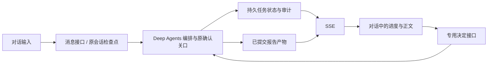

# V2 对话式工作台与 WorkflowBlocked 修复记录

日期：2026-10-31。范围：规划纯文本回复、持久对话、Web 状态/正文 SSE，以及整个工作台的对话交互。未修改四个角色的研究业务算法，未重跑截图中的付费研究。

## 原因与修复

只读检查真实会话 `5dc5e207ecb24a8da001bf17af48f9c6` 的 PostgreSQL 检查点，发现 `WorkflowBlocked('Planner returned no plan proposal')`。当时尚无计划产物，模型调用 1 次，已知实际用量 8,682 tokens。

旧规划中间件将所有不含计划工具调用的回复都作为失败。这会把合法的补充信息问题也拦掉。本次没有恢复被丢弃的原始回复，因此不能断言原回复的具体文字。

`runtime/scheduler.py` 现在接受规划阶段非空的普通回复，标记为等待用户补充，仍拒绝空回复与越权工具调用。正式计划仍须通过 `propose_plan` 提交，后续调度和人工确认均保留。

`runtime/conversation.py` 与 `runtime/session.py` 持久保存用户消息及主助手可展示的文本，排除工具调用和 reasoning 块。`awaiting_input` 仅由最后一条回复决定，历史追问不会把已完成回复重新变成等待补充。错误原因以安全文案保存；旧检查点的已知错误也能显示具体解释。

补充消息沿用原 report/thread/run/budget，不重置费用，不自动重试失败节点。唯一消息标识支持幂等；客户端遇到不确定的发送结果时，保留同一消息标识。已有计划或待确认关口时拒绝把普通消息当作批准；调整已形成的研究范围会新建对话，输入框有明确提示。

## 传输与界面

- `POST /api/reports/{id}/messages` 校验操作者、内容、唯一标识、取消状态、当前计划与待确认关口；未启动会话不能以空 run_id 接受补充，运行中消息在构建代理前拒绝；执行仍受会话锁保护。
- `GET /api/reports/{id}/events` 使用 `StreamingResponse`。同一连接发送变化后的 workspace；已提交报告按 1024 个 Unicode 码点发送分片，完成时发送长度与 SHA-256。
- `Last-Event-ID` 包含正文哈希和码点偏移，支持断线续传。相同正文但不同产物版本仍会更新版本；失效时发 `report.reset` 并清空事件游标。历史报告可按明确版本读取，失效正文不会冒充当前报告。
- 浏览器去重并检查偏移，收到完整正文后验证 SHA-256；失败可重新连接。事件源和定时器随页面卸载清理；断线后每 3 秒只读轮询状态。
- 这是**已提交报告的流式传输**。没有伪造逐字输出，也没有将未校验的模型推理/工具参数推给用户。写作期间展示实际阶段、来源数量、调用用量和活动状态，提交后发送正文。
- 页面改为历史侧栏、用户/助手消息、固定输入区、对话内确认、报告正文与详情抽屉。正文与详情共用安全 Markdown/登记图表渲染；不加载任意外部图片。
- 保留计划、分析、返工、人工审核和签署流程。审核决定携带 review_session_id/snapshot_id；硬问题或未完成检查不能通过；服务端签署条件不满足时禁用批准，仍可拒绝。
- 只在用户接近底部时跟随新内容，阅读上文时提供“回到最新”；移动端支持历史侧栏、Escape 关闭和窄屏排版。

## 实际验证

| 层次 | 结果与边界 |
| --- | --- |
| 默认 V2 回归 | `uv run --frozen pytest -q --tb=line`：329 passed，14 skipped。跳过项为现有真实 Docker 测试，本次未改动沙盒实现。 |
| 原生编排补测 | 新增真实 SupervisorFactory / Deep Agents、SQLite、原生 checkpoint 测试：追问 → 同一会话补充 → confirm_plan 暂停；2 次脚本模型调用，无子角色调用，无自动批准，run/budget 保留。补测通过。 |
| 最终定向回归 | scheduler、runtime、chat 和 Web 集成共 21 项通过，包含上述原生编排补测。 |
| 前端 | `pnpm build`（包含 typecheck）通过；Node 测试 6 项通过，覆盖 Unicode 续传、重复分片、偏移错误、早期失败进度、预算未知/超额与签署条件。 |
| 真实浏览器离线链路 | Playwright 经实际 FastAPI/SSE、临时 SQLite 和 LangGraph 检查点完成追问、刷新、补充、计划/分析确认、流式报告、签署、刷新校验、来源/预算抽屉。研究产物由脚本生成，不是实际财务结论。 |
| 网络流证据 | 实际接收 workspace busy=false → busy=true → report.start → 3 个 report.delta（offset 0/1024/2048）→ report.complete（length 2167）→ workspace busy=false。响应 `text/event-stream; charset=utf-8`，禁缓存与代理缓冲。 |
| 响应式 | 首页和历史阻塞会话分别验证 1440×1000、1280×800、768×900、390×844、320×700，无横向溢出；输入框可访问。 |
| 回归有效性 | 临时反转规划澄清保护条件后，回归测试按预期失败；恢复源文件后，21 项定向测试通过。 |
| 静态检查 | 本次涉及的 Python 文件 Ruff check 通过。Vite 保留既有 ECharts 延迟加载大分块警告。 |
| 用户历史会话 | 启动本机 8000 服务，只读 HTTP/浏览器打开截图任务：显示具体规划原因和补充输入框，仍为 failed；调用数仍为 1，已知实际用量仍为 8,682 tokens。没有替用户发消息、批准或重试。 |

浏览器脚本与夹具：`frontend/tests/chat-browser-check.mjs`、`frontend/tests/chat-responsive-check.mjs`、`tests/fakes/chat_server.py`。脚本仅允许 5187 的临时环境。截图存于被忽略的 `output/playwright/chat-home.png`、`chat-report.png`、`chat-mobile.png`、`chat-real-blocked.png`。

本机服务命令：`uv run --frozen rc serve --models config/models.toml`，访问 http://127.0.0.1:8000/。使用原有本地缺省规则模式，未改动规则审批、模型配置、预算上限或用户历史状态；本次不构成真实模型、外部数据源或生产合规验收。

## 官方依据

- [MDN：SSE、命名事件、id 与自动重连](https://developer.mozilla.org/en-US/docs/Web/API/Server-sent_events/Using_server-sent_events)
- [FastAPI：StreamingResponse](https://fastapi.tiangolo.com/advanced/custom-response/#streamingresponse)
- [React：useEffect 的连接和清理](https://react.dev/reference/react/useEffect)
- [LangGraph：interrupt 与 Command 恢复](https://docs.langchain.com/oss/python/langgraph/interrupts)

使用仓库锁定的 Deep Agents 0.7.32 和现有 LangGraph API，未升级依赖或替换执行机制。
