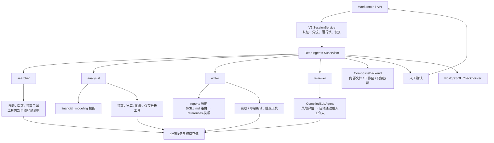
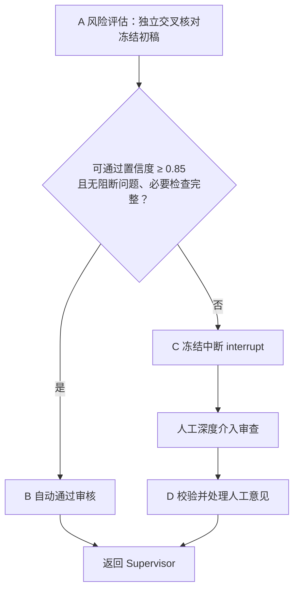

# Research Copilot V2：Deep Agents 编排与四角色协作详细设计

日期：2026-10-28  
状态：设计基线，尚未实施；代码示例尚未在项目中运行。  
来源：合并本次讨论中的顶层编排设计与四角色技能绑定设计。

配套文档：[SubAgent 业务逻辑详细设计](research-copilot-subagents-design.md)。该文档细化三个自主角色的提示词、工具、中间件和输入输出，以及 Reviewer 完整 StateGraph；Searcher 数据源确定为新浪财经 MCP + TickDB。

## 1. 目标与技术基线

### 1.1 改造目标

主要目标是减少自研运行机制的维护，次要目标是增强自主任务拆解与子代理协作。

采用：

> Deep Agents 顶层编排 → 三个自主循环 SubAgent + 一个 LangGraph 审核 CompiledSubAgent。

Deep Agents 接管模型／工具循环、文件式上下文、摘要卸载和子代理派发；项目保留证据校验、预算、权限、正式产物提交和人工审核等业务保障。

新代码位于 `src/research_copilot`。新任务使用 V2，历史报告继续可读；不将 V1 进行中的 checkpoint 转换为 V2。

### 1.2 技术基线与验证状态

本设计依据已检索的官方文档，并核对过 `deepagents==0.7.32` 发行包中的接口。

依赖基线：

```text
Python 3.13
deepagents ==0.7.32
langchain >=1.4.7,<2
langchain-core >=1.7.0,<2
```

其他依赖由锁文件记录精确版本。升级公共依赖时必须运行 V1 回归测试。

本文代码是设计示例，尚未在项目中运行，不代表真实模型兼容性已经验收。

参考：[Deep Agents 发行版](https://pypi.org/project/deepagents/0.7.32/)、[官方定制文档](https://docs.langchain.com/oss/python/deepagents/customization)。

### 1.3 第一阶段范围

完成：

- 顶层 Supervisor。
- 四个专业子代理的显式注册。
- 文件工作区、权限和角色技能绑定。
- LangGraph 子图接入契约。
- 预算、审计、暂停恢复与取消。
- 新旧任务分流及现有 UI 事件适配。

框架迁移本身不增加 Excel、递归派发或跨会话长期记忆。2026-10-29 已确认的 [Analysist 沙盒改造](research-copilot-analysist-sandbox-plan.md) 单独加入 analysist 专用 Docker execute、技能脚本、FCFF DCF 与敏感性分析；其他角色没有 execute，V1 与历史分析继续可读。

## 2. 总体架构与角色分工



### 2.1 Supervisor

负责理解目标、拆解任务、维护进度、选择角色、汇总结果，以及根据缺口安排补采或返工。

顶层不获得全部数据、计算和发布工具。正式业务操作由专门角色和受控工具完成。

### 2.2 四个显式子代理

名称固定为 `searcher`、`analysist`、`writer`、`reviewer`。保留用户指定的 `analysist` 拼写。

| 子代理 | 职责 | 技能 | 输出 |
|---|---|---|---|
| `searcher` | 搜索、读取、采集、登记证据 | 无 | 证据引用、来源和缺口 |
| `analysist` | 财务分析、指标计算、估值方法分析 | `financial_modeling` | 分析结果、指标和图表引用 |
| `writer` | 按报告类型组织正文与引用 | `reports` 单一技能 | 草稿、引用和待解决问题 |
| `reviewer` | 事实、引用、数值、结构与合规审核 | 无 | 问题位置、依据、严重程度、返工建议 |

前三个角色使用声明式 `SubAgent`，各自执行自主模型／工具循环，决定工具选择、顺序、重复执行和提交时机。工具内部执行必要的权限、口径和结构校验，不预设完整采集、分析或写作流水线。

`reviewer` 直接注册为 `CompiledSubAgent`，其 runnable 是 LangGraph 审核图；这张图就是审核子代理本身，而不是另一个审核 Agent 调用的工具。图负责风险评估、条件路由、人工中断和意见处理，结束后将审核结果返回 Supervisor。

例如 `analysist` 可先读取技能和证据，再多次计算、比较、调整方法，最后调用 `save_analysis`。计算工具不自动提交整个分析。第一阶段不再预建采集、分析、写作三张固定工作流图。

### 2.3 保留与替换

| 现有能力 | V2 处理 |
|---|---|
| 手写 Agent loop | 替换为 Deep Agents |
| 通用文件操作、待办、上下文卸载与摘要 | 使用框架机制 |
| 自研记忆工具和窗口裁剪 | V2 不再叠加同类机制 |
| 财务口径、来源和证据校验 | 保留并适配 |
| 版本、批准事务、执行凭据 | 保留 |
| V1 固定外层图 | 逐步拆为业务能力与子图 |
| 历史任务 | 继续由 V1 解释 |

## 3. 文件、权限、技能与上下文

### 3.1 Backend 设计

每个报告拥有独立磁盘工作区；Supervisor 实例绑定该报告，禁止跨报告复用带固定目录的全局实例。

虚拟路径：

```text
/workspace/
├── supervisor/
├── tasks/<dispatch_id>/
├── inputs/
├── evidence/
└── artifacts/

/instructions/AGENTS.md

/skills/analysist/financial_modeling/
/skills/writer/reports/
├── SKILL.md
└── references/
    ├── company_report.md
    ├── flash_comment.md
    ├── industry_report.md
    └── strategy_report.md
```

默认 `StateBackend` 保存框架内部卸载内容；真实项目材料通过 `FilesystemBackend` 路由。

```python
from pathlib import Path
from deepagents.backends import (
    CompositeBackend,
    FilesystemBackend,
    StateBackend,
)

def build_backend(report_root: Path, resources_root: Path):
    return CompositeBackend(
        default=StateBackend(),
        routes={
            "/workspace/": FilesystemBackend(
                root_dir=report_root.resolve(),
                virtual_mode=True,
            ),
            "/instructions/": FilesystemBackend(
                root_dir=(resources_root / "instructions").resolve(),
                virtual_mode=True,
            ),
            "/skills/": FilesystemBackend(
                root_dir=(resources_root / "skills").resolve(),
                virtual_mode=True,
            ),
        },
    )
```

框架支持组合路由；StateBackend 的线程持久化依赖 checkpoint。真实文件不会随 checkpoint 回退自动回滚。[官方后端文档](https://docs.langchain.com/oss/python/deepagents/backends)

因此：

- 笔记和草稿可重新生成。
- 正式产物通过业务服务按版本、哈希、幂等键提交。
- 子任务写入独占目录，由 Supervisor 汇总。
- 同一报告仅允许一个顶层运行。

### 3.2 文件权限

权限按声明顺序匹配，首个匹配生效，没有匹配时默认允许，因此设置明确兜底。[官方权限文档](https://docs.langchain.com/oss/python/deepagents/permissions)

Supervisor 仅可修改自身笔记：

```python
from deepagents import FilesystemPermission

SUPERVISOR_PERMISSIONS = [
    FilesystemPermission(
        operations=["read"],
        paths=["/**"],
        mode="allow",
    ),
    FilesystemPermission(
        operations=["write"],
        paths=["/workspace/supervisor/**"],
        mode="allow",
    ),
    FilesystemPermission(
        operations=["write"],
        paths=["/**"],
        mode="deny",
    ),
]
```

这里的根目录是报告专属虚拟文件系统，不是宿主机根目录。允许读取默认 StateBackend，是为了支持卸载材料回读。

子代理权限进一步收窄：

- 读取当前任务获准材料。
- 读取本角色技能及必要规则。
- 仅写入服务端分配的任务目录。
- 不直接修改证据、批准状态和正式产物。

派发入口生成可信 `dispatch_id` 与写入范围。角色文件 middleware 在调用文件工具前检查该范围，不能采信模型自报目录。

`permissions` 仅约束框架内置文件工具。MCP、数据库和自定义工具自行鉴权；第一阶段不暴露 Shell。上传入口及文件访问测试覆盖目录穿越、符号链接和 Windows junction。

### 3.3 技能绑定与适配

已核实：

- 现有财务技能目录和声明名称为 `financial_modeling`。
- V1 的 `reports` 目前包含四种独立报告技能；V2 将其整合为一个名为 `reports` 的技能。

用户所称 `financial-modeling` 映射到现有 `financial_modeling`，不改动 V1 标识。

绑定：

```python
analysist_skills = ["/skills/analysist/"]
writer_skills = ["/skills/writer/"]
```

这些路径指向包含技能子目录的容器。Writer 的容器内仅有 `reports` 一个技能；`references/` 中的模板是参考文档，不注册为独立技能。

`reports/SKILL.md` 使用框架标准的大写文件名，声明 `name: reports`，说明技能适用范围、模板选择规则、通用写作约束，以及各模板的相对路径。入口只保存路由说明，模板正文放在 `references/`，按需读取。

| 已确认的报告类型 | 使用场景 | 相对入口文件的模板路径 |
|---|---|---|
| `company_report` | 单一公司的基本面、财务、估值与投资价值深度研究 | `references/company_report.md` |
| `flash_comment` | 财报、公告或事件的短篇快速点评 | `references/flash_comment.md` |
| `industry_report` | 行业景气、竞争格局、政策与产业链研究 | `references/industry_report.md` |
| `strategy_report` | 宏观、市场策略、行业配置、主题与组合观点 | `references/strategy_report.md` |

Writer 先读取 `reports/SKILL.md`，再根据已确认的 `report_type` 读取对应模板，不一次性加载所有模板。报告类型缺失或与任务目标冲突时，返回缺口给 Supervisor 确认，不自行切换类型。

自定义子代理需要显式配置技能；不能依赖父代理继承。技能发现也不等于访问授权，实际文件权限独立控制。[官方子代理文档](https://docs.langchain.com/oss/python/deepagents/subagents)

V2 直接维护并打包角色技能资源，不依赖仓库根目录的外置技能源：

- 使用框架文件工具读取技能，不提供旧目录迁移或重生成入口。
- 财务技能保留原有参考文件结构；报告技能将四类模板正文归入 `reports/references/`，修正相对链接并保留各模板的业务约束。
- 通过资源版本和包内文件内容哈希校验完整性。
- V1 保留显式自定义目录与历史快照读取。
- 保留财务技能已有业务限制，不将方法论描述视为已实现计算能力。

Reviewer 可读取所采用模板作为审核依据，但不自动绑定 `reports` 技能。

### 3.4 上下文分层

| 载体 | 内容 |
|---|---|
| `system_prompt` | 角色职责和执行规则 |
| `memory` | 少量稳定规则 |
| `skills` | 按需加载的方法论 |
| 工作区文件 | 原文、数据、笔记、草稿 |
| Runtime context | 身份、报告、预算和策略引用 |
| Graph state | 消息、待办和框架运行状态 |
| 业务数据库 | 证据、批准、版本及执行凭据 |

```python
from dataclasses import dataclass

@dataclass(frozen=True, slots=True)
class RunContext:
    actor_id: str
    report_id: str
    run_id: str
    budget_id: str
    policy_version: str
```

身份由服务端认证并绑定，不从模型参数获取。密钥、连接对象不进入 checkpoint。恢复时重新构建 context，并核对任务策略版本。

保留框架摘要与大结果卸载，不再叠加旧 `ContextWindow.fit`。摘要不能成为正式证据；子代理仅返回必要摘要及产物引用。发送前检查上下文容量，摘要调用计入预算。[上下文工程](https://docs.langchain.com/oss/python/deepagents/context-engineering)、[Skills](https://docs.langchain.com/oss/python/deepagents/skills)。

## 4. Agent 构造、业务子图与运行控制

### 4.1 `create_deep_agent` 参数决策

| 参数 | 本项目配置 |
|---|---|
| `model` | 显式构造模型实例 |
| `tools` | 顶层状态和人工确认工具 |
| `system_prompt` | 协调职责、派发规则及完成条件 |
| `subagents` | 仅四个指定角色 |
| `backend` | 报告专属 CompositeBackend |
| `permissions` | 显式角色权限 |
| `memory` | 只读规则文件 |
| `skills` | 顶层为空，技能绑定到角色 |
| `middleware` | 文件工具配置、预算、派发、审计 |
| `interrupt_on` | 计划、分析、返工和签署 |
| `response_format` | 顶层 `None`；业务结果独立校验 |
| `state_schema` | 第一阶段使用默认 state |
| `context_schema` | `RunContext` |
| `checkpointer` | 生产 PostgreSQL，测试内存 |
| `store` / `cache` | 第一阶段均为 `None` |
| `name` | 固定 Supervisor 名称 |
| `debug` | 生产关闭 |

### 4.2 多厂商模型接入：统一使用 OpenAI Python SDK

使用 `openai` 库的 `AsyncOpenAI` 作为统一请求客户端，通过厂商配置选择 `base_url`、凭据及模型。支持范围是提供 OpenAI-compatible Chat Completions 接口的厂商或网关；非兼容原生接口不能仅修改 URL 接入。本阶段不混用 Responses 协议，不为每个厂商引入独立的 LangChain 模型包。

Deep Agents 需要 LangChain 模型接口，不能直接将 `AsyncOpenAI` 传给 `create_deep_agent(model=...)`。新增项目级 `OpenAICompatibleChatModel(BaseChatModel)`，仅承担协议转换、请求计量和能力适配；Agent 循环仍完全由 Deep Agents 执行。

```text
Supervisor / 四个 SubAgent
    → OpenAICompatibleChatModel（BaseChatModel 适配）
    → AsyncOpenAI.chat.completions.create
    → 配置指定的厂商兼容接口
```

#### 配置与角色绑定

厂商连接和角色模型分开配置：

| 配置层 | 字段 |
|---|---|
| 厂商连接 | `provider_id`、`base_url`、`api_key_env`、`timeout_seconds` |
| 角色绑定 | `provider_id`、`model`、`max_output_tokens`、可选 `temperature` |
| 模型能力 | 上下文容量、工具调用、流式、JSON 能力、输出 token 参数名 |
| 厂商扩展 | 经验证的思考参数、额外请求字段和响应字段映射 |

`supervisor`、`searcher`、`analysist`、`writer`、`reviewer` 可以分别绑定不同厂商和模型。配置记录环境变量名，不保存密钥正文。模型名原样传给厂商，不自动替换为默认模型。

#### 客户端构造示例

```python
import os
from dataclasses import dataclass
from openai import AsyncOpenAI

@dataclass(frozen=True, slots=True)
class ProviderConfig:
    provider_id: str
    base_url: str
    api_key_env: str
    timeout_seconds: float = 60.0

def build_sdk_client(config: ProviderConfig) -> AsyncOpenAI:
    return AsyncOpenAI(
        api_key=os.environ[config.api_key_env],
        base_url=config.base_url,
        timeout=config.timeout_seconds,
        max_retries=0,
    )

async def request_completion(client, *, model, messages, tools):
    # 仅展示 SDK 调用形状；预算预占、参数映射和响应转换由适配器完成。
    payload = {"model": model, "messages": messages}
    if tools:
        payload["tools"] = tools
    return await client.chat.completions.create(**payload)
```

SDK 客户端按连接配置复用，由应用生命周期统一 `await client.close()`；不在每轮调用重建客户端，也不通过修改全局环境变量切换厂商。不同 endpoint 和凭据的客户端保持隔离。

#### Deep Agents 模型适配器契约

`OpenAICompatibleChatModel` 是待实现的项目类型，不是 SDK 内置类：

- 实现 `BaseChatModel` 所需的 `_generate`、`_agenerate`、模型标识及 `bind_tools`；同步调用走独立同步客户端，不能在已有事件循环中使用 `asyncio.run`。
- 实现流式接口与工具调用分片合并；不支持流式的模型显式退回完整响应，不伪造 token 流。
- 将 LangChain 消息和工具 schema 转成 Chat Completions 请求，将响应还原为 `AIMessage`／流式 chunk，保留工具调用 ID、参数、finish reason、request ID 和 usage。
- 按厂商能力映射输出 token 限制和思考参数；`reasoning_content` 等扩展字段按对应厂商协议保留及回传，不向所有厂商无差别发送。
- 工具调用为四角色运行的必要能力；配置不支持时在启动校验中拒绝。JSON Schema、JSON mode 和纯文本能力分别声明，不假定兼容接口能力一致。
- 在实际请求层统一预占和结算预算，包括框架摘要调用；保留取消与错误分类。usage 缺失记为未知，不按零费用结算。
- 显式提供模型上下文容量与 token 估算策略，不依赖框架自动识别厂商别名。
- 模型元数据保存真实 `provider_id` 和模型名；密钥与认证请求头不进入 trace、state 或 checkpoint。

关闭 SDK 隐式重试，不配置自动供应商 fallback。兼容性失败时先修复协议适配，不重新嵌入旧 loop。

来源：[OpenAI Python SDK](https://developers.openai.com/api/reference/python)、[LangChain 模型接口](https://docs.langchain.com/oss/python/langchain/models)。上述多厂商能力映射与预算规则属于项目设计，不能由 SDK 支持自定义 endpoint 推断所有厂商已经通过兼容验收。

### 4.3 四角色注册

```python
from deepagents import SubAgent, CompiledSubAgent

ROLE_NAMES = ("searcher", "analysist", "writer", "reviewer")
AUTONOMOUS_ROLES = ("searcher", "analysist", "writer")

ROLE_CONFIG = {
    "searcher": {
        "description": "搜索、采集和核实研究材料，登记证据并报告缺口。",
        "system_prompt": (
            "负责证据采集。使用受控工具登记来源；"
            "返回引用和缺口，不编造来源。"
        ),
        "skills": [],
    },
    "analysist": {
        "description": "基于授权证据进行财务分析、计算和估值方法分析。",
        "system_prompt": (
            "先读取 financial_modeling 技能入口，再按需读取参考资料。"
            "计算使用已注册工具，区分事实、假设和估计。"
            "数据不足时报告补采需求。"
        ),
        "skills": ["/skills/analysist/"],
    },
    "writer": {
        "description": "按已确认报告类型、证据和分析结果撰写报告。",
        "system_prompt": (
            "先读取 reports/SKILL.md 的模板选择规则，"
            "再按已确认的 report_type 读取 references/ 中的对应模板。"
            "只使用已授权证据和已确认分析，不编造数字或切换模板。"
        ),
        "skills": ["/skills/writer/"],
    },

}

def build_subagents(
    *,
    models,
    tools,
    permissions,
    middleware_factory,
    review_graph,
) -> list[SubAgent | CompiledSubAgent]:
    autonomous = [
        {
            "name": name,
            **ROLE_CONFIG[name],
            "model": models[name],
            "tools": tools[name],
            "permissions": permissions[name],
            "middleware": middleware_factory(name),
        }
        for name in AUTONOMOUS_ROLES
    ]
    reviewer: CompiledSubAgent = {
        "name": "reviewer",
        "description": (
            "对冻结初稿进行独立交叉核对与风险评估；"
            "高置信通过或中断请求人工深度审查，返回审核决定与意见。"
        ),
        "runnable": review_graph,
    }
    return [*autonomous, reviewer]
```

前三个子代理分别创建 middleware。审核图通过节点和业务服务显式接入模型、预算、权限与审计，不继承声明式 SubAgent 的工具、技能和 middleware 配置。四个角色共享可信预算引用，不共享任意可变运行状态。

### 4.4 禁用默认通用子代理

```python
from deepagents import (
    GeneralPurposeSubagentProfile,
    HarnessProfile,
    register_harness_profile,
)

def register_profiles(profile_keys):
    # 适配器按已锁定版本的模型识别规则提供稳定 profile key。
    for key in set(profile_keys):
        register_harness_profile(
            key,
            HarnessProfile(
                general_purpose_subagent=GeneralPurposeSubagentProfile(
                    enabled=False,
                ),
            ),
        )
```

启动时为 Supervisor、四个角色实际使用的模型注册 profile，并测试自定义模型适配器的匹配结果；不能继续硬编码 `deepseek`。profile 的框架匹配身份与审计用真实厂商身份分别维护，新增模型必须通过“没有默认通用子代理”的装配测试。

Profile API 标记为 Beta，因此锁定版本并测试注册结果。角色子代理不得暴露继续派发的 `task` 工具。[官方 Profiles 文档](https://docs.langchain.com/oss/python/deepagents/profiles)

### 4.5 顶层构造

```python
from deepagents import FilesystemMiddleware, create_deep_agent

def build_supervisor(
    *,
    model,
    backend,
    checkpointer,
    top_tools,
    subagents,
    business_middleware,
):
    assert {s["name"] for s in subagents} == set(ROLE_NAMES)

    return create_deep_agent(
        model=model,
        name="research-copilot-v2-supervisor",
        system_prompt=(
            "你是研究协调者，负责拆解任务、管理进度和汇总结果。"
            "采集交给 searcher，分析交给 analysist，"
            "写作交给 writer，审核交给 reviewer。"
            "按缺口安排补采或返工，正式操作遵守业务确认条件。"
            "待办完成不代表报告获批，文件存在不代表提交成功。"
        ),
        tools=top_tools,
        subagents=subagents,
        backend=backend,
        permissions=SUPERVISOR_PERMISSIONS,
        memory=["/instructions/AGENTS.md"],
        skills=[],
        middleware=[
            FilesystemMiddleware(
                backend=backend,
                tools=[
                    "ls", "read_file", "write_file",
                    "edit_file", "glob", "grep",
                ],
                tool_token_limit_before_evict=8000,
                human_message_token_limit_before_evict=12000,
            ),
            *business_middleware,
        ],
        interrupt_on={
            name: {"allowed_decisions": ["approve", "reject"]}
            for name in (
                "confirm_plan",
                "confirm_analysis",
                "confirm_rework",
                "signoff_report",
            )
        },
        response_format=None,
        context_schema=RunContext,
        checkpointer=checkpointer,
        store=None,
        cache=None,
        debug=False,
    )
```

四个确认工具必须真实注册。卸载阈值是项目初始配置，不是框架强制值。

子代理必须显式配置文件工具集合。只有 analysist 使用完整 SandboxBackendProtocol 后端并暴露 execute；Supervisor、searcher、writer 与 reviewer 不获得执行工具。Deep Agents 0.7.32 不支持给执行后端配置文件 permissions，analysist 文件访问由 RoleFileScopeMiddleware、RoleBusinessMiddleware 和受控文件后端限制，容器隔离由 Docker 强制；其他角色继续使用框架 permissions。`tools=[]` 不代表移除框架内置工具。

### 4.6 Reviewer：LangGraph CompiledSubAgent

#### 审核流程



- 输入绑定报告、草稿版本及内容哈希，并冻结证据、分析、模板与审核规则引用。输入授权由可信运行上下文验证，不能接受任意文件作为正式待审报告。
- A 执行独立视角的事实、引用、数值、结构与合规检查，产出问题清单和 `pass_confidence`（对当前版本满足审核条件的置信度，不是风险概率）。输出通过 Schema 校验；分数只作为路由指标，未经校准不宣称等于真实正确概率。
- 阈值默认 `0.85`；图片未定义等于阈值的分支，本设计将其归入自动通过候选。仅在分数不低于阈值、无阻断问题且必要检查完整时进入 B。分数高不能覆盖已发现的错误。
- C 在不足以自动通过时触发 `interrupt()`，向 UI 提交审核快照标识、问题和审阅材料引用。输入缺失或格式错误在 A 之前拒绝；网络故障记录为运行失败，不伪造审核分数。
- 人工决定支持 `approve`、`request_changes`、`reject`。D 验证决定、审核人身份、快照与意见，幂等保存审核记录；请求修改或驳回时返回 Supervisor，由其决定派发 Writer、Analysist 或 Searcher。
- B/D 返回 `passed`、`changes_requested` 或 `rejected`，包含摘要、问题、意见及被审版本引用。结果用最后一条 `AIMessage` 的 JSON 正文返回；父侧校验后才推进业务状态。
- 自动通过仅表示当前版本审核通过，不替代人工最终签署。修改后产生新版本，必须重新审核；旧批准不能沿用到新内容。

#### 图装配代码示例

以下为图的结构示例，注入的服务与契约必须真实实现；不是完整审核实现。

```python
import json
from typing import NotRequired
from langchain_core.messages import AIMessage
from langgraph.graph import StateGraph, MessagesState, START, END
from langgraph.runtime import Runtime
from langgraph.types import interrupt

class ReviewState(MessagesState):
    snapshot: NotRequired[dict]
    assessment: NotRequired[dict]
    human_decision: NotRequired[dict]

def build_review_graph(service):
    async def assess(state: ReviewState, runtime: Runtime[RunContext]):
        # 解析派发消息、授权并取得不可变快照；评估结果须校验。
        snapshot, assessment = await service.assess(
            state["messages"], runtime.context,
        )
        return {"snapshot": snapshot, "assessment": assessment}

    def route(state: ReviewState):
        a = state["assessment"]
        eligible = (
            a["pass_confidence"] >= 0.85
            and not a["has_blocking_issues"]
            and a["checks_complete"]
        )
        return "auto_pass" if eligible else "human_review"

    async def auto_pass(state: ReviewState, runtime: Runtime[RunContext]):
        result = await service.record_auto_pass(
            state["snapshot"], state["assessment"], runtime.context,
        )
        return {"messages": [AIMessage(content=json.dumps(result, ensure_ascii=False))]}

    def human_review(state: ReviewState):
        # 此节点恢复时会重新执行；interrupt 前无外部写入。
        decision = interrupt({
            "kind": "reviewer_deep_review",
            "snapshot": state["snapshot"],
            "assessment": state["assessment"],
            "allowed_decisions": ["approve", "request_changes", "reject"],
        })
        return {"human_decision": decision}

    async def process_feedback(state: ReviewState, runtime: Runtime[RunContext]):
        result = await service.record_human_decision(
            snapshot=state["snapshot"],
            assessment=state["assessment"],
            decision=state["human_decision"],
            context=runtime.context,
        )
        return {"messages": [AIMessage(content=json.dumps(result, ensure_ascii=False))]}

    graph = StateGraph(ReviewState, context_schema=RunContext)
    graph.add_node("assess", assess)
    graph.add_node("auto_pass", auto_pass)
    graph.add_node("human_review", human_review)
    graph.add_node("process_feedback", process_feedback)
    graph.add_edge(START, "assess")
    graph.add_conditional_edges("assess", route, {
        "auto_pass": "auto_pass",
        "human_review": "human_review",
    })
    graph.add_edge("human_review", "process_feedback")
    graph.add_edge("auto_pass", END)
    graph.add_edge("process_feedback", END)
    return graph.compile()
```

审核图保留 `messages` 通道以符合 `CompiledSubAgent` 通信接口。父图配置持久化 checkpointer；嵌套审核图采用父运行上下文，不手动固定共享的子图 namespace。该调用链的暂停传播、重启恢复与状态读取必须在锁定版本中集成验证。

原生 `interrupt()` 与顶层工具 `interrupt_on` 的恢复载荷不同。SessionService 按中断类型分派：本审核节点恢复值是审核决定对象，不能套用工具审批的 `decisions` 列表；多个中断按 interrupt ID 对应恢复。恢复仍从顶层运行入口提交，不单独重启审核图。不得捕获图中断并转成普通工具失败，也不得把整个 `task` 统一设为审批点。

服务端验证审核人及待审快照；UI 暂停期间内容如已变化，拒绝旧决定并发起新版本审核。B/D 的业务写入具有幂等键，避免 checkpoint 前后失败导致重复批准。A 已完成的模型评估不因等待人工而再次执行。

来源：[CompiledSubAgent](https://docs.langchain.com/oss/python/deepagents/subagents)、[LangGraph 中断与恢复](https://docs.langchain.com/oss/python/langgraph/interrupts)。

### 4.7 预算、并发与副作用

- 顶层、子代理及摘要请求共享预算账本。
- 每次实际模型请求预占额度，完成后结算。
- 摘要内部调用可能不经过普通模型 middleware，模型调用层也必须计量。
- 默认最多同时执行 3 个子任务。
- 取消时停止排队任务，等待在途任务收尾并保留结果。
- `recursion_limit` 只是图执行保护，不替代预算。
- 正式提交采用业务幂等键，不仅使用模型 tool-call ID。
- 不自动重跑完整任务，也不开放递归或远程异步子代理。

## 5. 会话接口、实施与验收

### 5.1 会话服务

```python
class SessionService:
    async def start(self, report_id, actor_id, message): ...
    async def resume(self, report_id, actor_id, decision): ...
    async def cancel(self, report_id, actor_id): ...
    async def get_status(self, report_id, actor_id): ...
```

任务记录保存 `runtime_version`，服务端据此分流。

V2 使用独立 thread 标识：

```python
config = {
    "configurable": {"thread_id": f"v2:{report_id}"},
    "recursion_limit": 100,
}

result = await agent.ainvoke(
    {"messages": [{"role": "user", "content": user_request}]},
    config=config,
    context=context,
)
```

生产 checkpoint 使用 PostgreSQL，由应用生命周期管理连接。

### 5.2 人工确认与恢复

保留计划、分析、返工及最终签署语义。

`interrupt_on` 提供交互暂停；业务服务验证批准条件。即使 Agent 没主动请求确认，未获批准的下游操作仍必须拒绝。

单个待处理 interrupt 的恢复形状：

```python
from langgraph.types import Command

result = await agent.ainvoke(
    Command(resume={"decisions": [{"type": "approve"}]}),
    config=config,
    context=context,
)
```

生产入口验证用户、当前 interrupt、动作数量及产物版本；多个 interrupt 分别按标识处理。[官方 HITL 文档](https://docs.langchain.com/oss/python/deepagents/human-in-the-loop)

恢复不增加原授权预算。提交已完成而 checkpoint 未保存时，重放返回原凭据；批准成功但导出失败时，仅重试导出。

### 5.3 目录职责

```text
research_copilot/
├── orchestration/   # 顶层工厂与角色注册
├── runtime/         # 会话、上下文、预算和生命周期
├── llm/             # OpenAI SDK 客户端、BaseChatModel 适配与厂商能力配置
├── workspace/       # 后端、权限与技能资源准备
├── subgraphs/       # Reviewer 审核图及节点
├── tools/           # 前三个自主角色工具及受控业务服务适配
├── contracts/       # 结果及事件契约
└── resources/       # V2 规则与适配后的技能
```

### 5.4 实施顺序

1. **依赖与协议**：锁定版本，验证 V1 回归、模型消息与工具协议。
2. **顶层与工作区**：完成四角色注册、文件权限、技能适配和运行锁。
3. **角色实现**：依次接入搜索、分析、写作自主循环与工具，再实现 Reviewer 审核图；每个角色完成契约、测试与业务验收后推进。
4. **运行保障**：完成全局预算、取消、幂等和 PostgreSQL 恢复。
5. **交互适配**：连接现有 UI 事件、确认流程和新旧任务分流。

未实现的角色能力明确报告不可用，不以占位成功结果通过验收。

### 5.5 验收清单

| 类别 | 必须验证 |
|---|---|
| 注册 | 恰好四个指定子代理，无默认通用代理 |
| 派发 | 子代理无递归派发；并发上限与取消生效 |
| 技能 | Analysist 加载财务技能；Writer 仅发现 reports 技能，先读入口再按类型读取 references 模板 |
| 模板路由 | 四种报告类型映射正确；相对链接有效；类型缺失或冲突时报告缺口，不默认套用模板 |
| 技能迁移 | V2 指令不依赖旧 `load_skill`；参考文件完整 |
| 权限 | Skills、证据和正式产物受保护；任务目录隔离 |
| 上下文 | 卸载可回读；摘要保留正式引用入口 |
| 预算 | 顶层、子代理、摘要全部计量 |
| 自主循环 | 前三个角色能按结果调整工具顺序和重复计算，计算不会自动提交整体分析 |
| 审核图 | 0.85 阈值上下及等值分支；阻断问题或检查不完整禁止自动通过；人工批准、修改和驳回正确 |
| 嵌套恢复 | Reviewer 中断透传顶层，重启后按 ID 恢复；不重复风险评估或审核提交；旧版本决定被拒绝 |
| 人工确认 | 未批准时拒绝操作；批准绑定具体版本 |
| 恢复 | 重启后可恢复；重复执行不重复提交 |
| 模型 | 至少两组厂商配置的协议夹具通过；角色可独立选厂商；reasoning、工具消息、流式分片、错误分类和 usage 保真 |
| 厂商隔离 | endpoint／凭据不串用；不支持的能力启动拒绝；摘要请求计费；客户端关闭和取消正确 |
| 兼容 | 历史报告可读；旧任务不进入 V2 |
| 审核 | Reviewer 不能自行签署或改写正式报告 |

验收分开记录：

- 离线单元与组件测试。
- 真实数据库及文件系统集成。
- 单独授权的真实模型验收。

第一阶段完成意味着：V2 已具备三个自主循环角色、一个可中断恢复的审核 CompiledSubAgent、角色专属技能和文件式上下文；不等于全部报告链和财务建模能力已经迁移完成。
