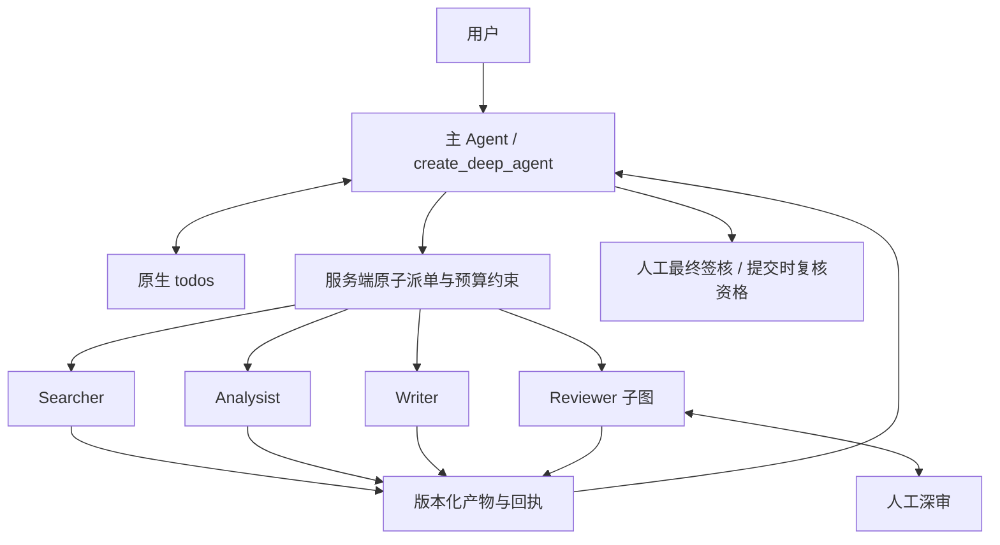

# Research-Copilot 主 Agent 自主规划与执行实施方案

状态：本次授权范围实现与工程验证完成；真实模型验收未执行。详见[验收记录](autonomous-workflow-acceptance-20261107.md)。用户已确认并授权实施。本文件替代此前草案；旧草案中“自动提交工作树”“前端零改动”、提高来源/执行额度等决定均不适用。

## 已确认范围

由 create_deep_agent 主 Agent 维护原生 todos、动态派单及返工；没有独立 Planner。删除新流程的计划、分析、返工确认，保留最终签核与 Reviewer 人工深审。todos 仅展示进度，不能授权业务操作。仅新会话使用 products-v2；旧会话只读，不迁移检查点。保留 210 万 tokens、80 次模型调用及阶段预算，增加每报告 12 次有效派单上限，重放不重复计数。允许已知格式/输入错误有界修复，未知用量、执行结果及预算耗尽必须停止。

## 实现边界

- 显式接入 TodoListMiddleware，仅主 Agent 使用；退出 ProductWorkflowMiddleware 和 next_action 指令；保留预算、压缩、角色隔离及受控提交。
- ReportScope 冻结 objective/report_type/as_of，复用 research_as_of。首次派单前登记，不生成虚假的批准计划。
- TaskBrief 在服务端原子校验并冻结；task_id、dispatch_id 和服务端工作组分别表达逻辑任务、执行尝试、累计额度。变更任务身份不能重置额度。
- Writer 必须引用有效分析，Reviewer 必须引用当前报告；产物变化撤销下游签核资格。投影和签核提交共用资格校验。
- ask_user 使用持久化中断及经过校验的恢复载荷。普通消息不能代替审核/签核。
- 保留角色内部格式修复；主 Agent 每逻辑失败最多一次修正派单，修正占用 12 次额度且不能重置来源/执行次数。未知提交先核实，禁止盲重试。
- 工作台区分 todos 与实际 tasks，显示等待原因及剩余额度；移除固定阶段推断完成。历史只读覆盖 API、队列、恢复和 UI。
- 保留旧序列化类型。历史显示从持久化记录读取，不能为读取历史创建可执行模型图。

## 分阶段实施与验收

| 阶段 | 内容 | 验收 |
|---|---|---|
| M0 | 核对工作树、保存规格 | 保留原有修改，不自动提交 |
| M1 | 范围、任务登记、原子计数、工作组 | 非法不占名额，12/13 边界，并发/重放，改 ID 不重置 |
| M2 | 原生规划、动态编排、上下文 | 无固定合成派单，真实主 Agent 决策 |
| M3 | 澄清、返工、深审、签核、修复 | 仅必要人工中断，未知结果不自动重试 |
| M4 | 工作台、版本切换、历史只读 | 前后端一致，所有旧执行入口拒绝 |
| M5 | 回归、运行与交付说明 | 分层记录已验证和未验证证据 |

## 必测与发布

测试自主补采、分析返修、审核返工；非法角色/ID/输入版本；并发最后名额与重放；变更任务身份绕限额；深审问题处置、签核版本变化与重复提交；未知模型/沙盒执行及预算停止；HTTP/SSE 乱序、刷新、历史只读；跨报告隔离及配置失效时历史可读。

默认 CI 离线测试与 PostgreSQL、Docker、浏览器验证分别记录；真实模型和来源需另行授权，离线通过不代表真实质量验收。切换前收尾旧运行，不自动释放未知占用。回退停止新任务准入，兼容读取 products-v2，不能让旧引擎接管新检查点。不自动提交、部署、执行付费模型。取消固定调度可能增加调用次数，不承诺成本下降。

## 当前证据

- M0：已核对既有大量未提交改动，本次增量实施。
- M1–M5：已实现并完成本次离线、PostgreSQL、Docker、浏览器和静态检查。计数、命令、证据及未执行边界以验收记录为准，不将本设计文档本身作为实现证据。
