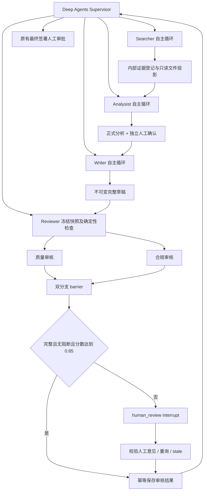

# Research Copilot V2：SubAgent 实现与分阶段验证

> 历史实施快照（2026-10-29），不是当前入口/错误处理契约。当前默认 `products-v1`、严格 TaskBrief/业务结果边界与数值校验见[工程化实施记录](engineering-implementation-20261105.md)。当前 ToolStrategy 使用 `result_repair_message` 进行受限结构修复，早期 `handle_errors=False` 记录不再代表现状。

日期：2026-10-29。依据：[SubAgent 业务逻辑详细设计](research-copilot-subagents-design.md)。

四个业务角色已接入 V2 主编排工厂。此次实现不切换既有 Web/CLI 默认入口，不迁移 V1 checkpoint，不执行真实付费模型、真实新浪/TickDB 请求或 PostgreSQL 验收。

## 角色与运行方式

| 角色 | 实现 | 正式成果与边界 |
|---|---|---|
| Searcher | 声明式 SubAgent；动态批准的新浪 / TickDB 工具；既有 WebSearch 的 V2 存储桥接 | 自动登记外部证据；返回正式 ID、文件路径、原始内容哈希；无 `get_evidence`、`register_evidence` 或 `cne_*` 工具 |
| Analysist | 声明式 SubAgent；标准技能脚本与 Docker execute | 增长、比率、估值、期间差分、比较表、FCFF DCF 与敏感性；Matplotlib/ECharts 图表；执行凭据登记后独立保存；不联网、不自行批准；未实现的三表/LBO 不宣称完成 |
| Writer | 声明式 SubAgent；`reports` 入口与已确认类型模板 | 完整 Markdown 草稿的编辑、校验、再校验提交；服务生成来源脚注、分析附录及冻结规则声明；草稿不等于审核通过 |
| Reviewer | `CompiledSubAgent` + LangGraph | 冻结完整报告与材料；确定性检查；独立质量 / 合规循环；列表边汇合；自动通过或原生人工中断；幂等提交 |

三个自主角色使用 `ToolStrategy(..., handle_errors=False)`。未实现新的手工 Agent loop。Reviewer 的两个内部审核器使用框架 `create_agent`，只注册快照读取工具，不成为额外顶层角色。



## 工厂配置

`SupervisorFactory` 默认装配真实业务角色。可显式传入 `RoleServices`，否则复用 `BusinessCoordinator.role_services` 或基于其权威 repository 创建。`role_tools={}` 是兼容占位测试的显式入口；不能将它误用为生产业务配置。

```python
from research_copilot.orchestration.factory import SupervisorFactory
from research_copilot.subagents.services import RoleServices
from research_copilot.subagents.web import WebSources
from research_copilot.workspace import bundled_resources

services = RoleServices(
    repository=store,
    workspace_root=workspace_root,
    business=business,
    report_rules=approved_rules_snapshot,
)
web_sources = WebSources(services, slots=approved_search_provider_slots,
                         domain_filter=domain_filter)
factory = SupervisorFactory(
    models=models, store=store, business=business,
    checkpointer=checkpointer, workspace_root=workspace_root,
    resources_root=bundled_resources(), role_services=services,
    source_tools=discovered_approved_mcp_sources,
    web_sources=web_sources,
)
store.resume_validator = business.validate_resume
```

上述变量由现有宿主提供。构造工厂不会调用模型或发起外部数据请求。会话入口仍使用现有 `SessionService`，其恢复路径校验操作者、report/run/budget/policy 和中断 ID。规则缺省从 `config/compliance_rules.yaml` 加载；当前示例规则会形成硬性阻断，不能用通用人工 approve 绕过。

新浪连接使用 `sina_parameters(token)` 与 `open_mcp_sources(parameters, server="sina_finance", approved=...)`。`approved` 必须是实际发现后审核的原工具名与 schema 指纹映射，不在代码中猜测 API。TickDB 同样使用该生命周期适配器，传入现有 TickDB HTTPS / 请求头连接参数，`server="tickdb"`。客户端负责 initialize 和分页 tools/list，适配器拒绝 schema 漂移、写工具和不安全的连接认证配置。

宿主从环境读取凭据，连接管理器只将其放入请求头，并在 MCP trace 写入前过滤响应中的凭据回显。共享 MCPClient 新增可选 `result_filter`，缺省行为保留；没有修改 V1 数据源选择或历史数据。

未配置数据源时保留真实角色及工具能力边界，由 Searcher 返回缺口，不静默切回 CNEquity。配置准备和离线 HTTP 协议测试不代表真实授权接入通过。

## 公共契约的显式映射

- `TaskBrief` 是业务内容，不提供身份或权限。结构化 brief 会冻结到派发记录，核对角色及最终 `task_id`；兼容普通任务描述。实际权限始终来自服务端 `Dispatch` 和冻结材料。
- 业务工具在模型边界返回 `BusinessToolResult`：`ok / data / receipt_id / error`。候选参数错误可在同一循环内修正；权限、哈希、取消、预算、持久化和图中断不会被转成普通可继续的业务错误。最终结构化输出错误不会触发整个任务自动重跑。
- `SearchResult / AnalysisResult / WritingResult` 保留在权威记录。既有主控 `RoleResult` 的 `completed` 保持；`partial / blocked` 映射为 `needs_input`，保留具体 gaps。
- 正式产物使用既有 `artifact_id / version / content_hash` 契约。证据也映射进主控 `references`，版本为不可变的 `1`；其 ID 和哈希由登记服务核验。覆盖清单、假设、限制、指标等完整业务结果通过 `get_report_status.latest_role_results` 查询。
- Reviewer 对外映射为既有 `ReviewResult`；新增 `stale` 表示冻结版本过期。完整审核、分数、来源与人工意见保存在权威 review 记录，由 `get_report_status.latest_review` 查询。父侧只接受已经提交的审核凭据。

## 证据、文件与幂等

每次派发建立独立的证据索引 `/workspace/evidence/<dispatch_id>/index.json` 和只读产物投影 `/workspace/artifacts/<dispatch_id>/`。文件枚举、搜索及读取均校验派发范围、登记身份与投影哈希；跨派发材料、未登记输入和模型写证据被拒绝。

原始内容哈希与文件投影哈希分开。投影使用 `v2-json-segments-1`：长字符串表示为 `text_segments`，用 `join=""` 精确连接；原始正文不被改写。多行文件让原生 `read_file` 的 offset/limit 分页实际有效，`grep` 也可定位正文。

外部请求前保存开始状态，返回后先保留不可变原始响应，再登记数据库。登记失败时恢复已有响应，不重复外部请求；完成状态未知时停止，等待显式诊断。来源、工具、参数和内容身份参与登记幂等，不能因不同证券碰巧返回相同数字而合并来源。

Web Search 复用原有 `WebSearch` 内部请求锁、规范 URL 合并、缓存与 provider 状态；没有添加模型前置查重。摘要和原文登记为不同证据并保留父链。附件由宿主先完成 `WorkspaceFiles.import_input`，再调用 `RoleServices.register_attachment(context, receipt)`，不暴露登记工具。二进制原件按原始字节编码保存，不把它冒充已解析正文。

保存分析与草稿都核验正式凭据及其血缘。图表在保存分析和写作读取时重验文件哈希。相同工具重放与同派发中相同内容的重复提交复用版本；不同并发草稿不能覆盖冻结输入。报告签署、分析确认和审核通过仍是独立状态。

## Reviewer 与恢复

快照包含全文、真实附录、证据、确认分析、指标、图表、采用模板、规则、阈值和哈希。报告按章节及附录分片，过长分片再按上限切分。服务记录每个分支实际读取的必检目标；模型自报“已读完”不能代替覆盖证明。

质量与合规分支分别写 State 中不同 key，由列表边汇合。聚合分数取最小值；0.85 等值进入自动通过候选，但仍要求确定性检查、两个分支覆盖完整且没有阻断问题。此分数未校准，不代表真实正确概率。缺失、非法分数或分支执行失败不会降级成通过，也不冒充人工内容审核。

人工支持 approve、request_changes、reject。阻断模型问题要给出有理由的误报裁决；硬性完整性或策略问题、检查不完整不能用通用批准绕过。错误意见回到同一中断节点，不重跑模型审核。草稿变化返回 stale；finalize 事务再次重验当前版本并幂等保存。

修改请求生成绑定审核记录及原草稿的返工引用，继续派发前走原有 `confirm_rework` 人工确认。审核 passed 只设置当前版本已审，不执行 `signoff_report`。

模型标识与容量、资源 manifest、来源 schema 和规则配置冻结到运行记录。中途配置变化拒绝复用旧派发。工厂中所有模型请求，包括角色及内部摘要，共享预算并写请求审计；不将客户端或凭据放进 `RunContext`。SQLite 离线存储增加独立 mutation lock，以模拟 PostgreSQL 行锁对并行分支更新的保护；这不代表 PostgreSQL 并发已验收。

## 分阶段验证记录

按角色顺序推进，每阶段先看到新增测试失败，再实现并通过对应集成测试后进入下一角色：

| 阶段 | 当时累计离线集成结果 | 验证重点 |
|---|---:|---|
| Searcher | 4 passed | 主控原生 task、MCP schema 批准、登记与文件哈希、失败复用和恢复 |
| Analysist | 7 passed | 真实数值解析及计算、口径拒绝、图表、原生循环及独立保存 |
| Writer | 10 passed | 技能模板读取、完整草稿、重验引用、不可变版本；不自动批准 |
| Reviewer | 14 passed | 双分支、0.85 等值、人工重询、父图重建恢复、快照哈希 |

后续增加了协议、边界和恢复回归：真实 MCP 客户端配合离线 HTTP 夹具完成 initialize / 分页 / 认证 / 调用；真实 OpenAI SDK 配合 MockTransport 验证结构化工具请求；取消、原始响应恢复、证据分页、任务与配置冻结、旧分析隔离、审核过期、硬性阻断、返工审批、假审核凭据、模板假读、候选修正及重复提交。

变异检查：临时将自动通过的 `score >= threshold` 改为 `score < threshold`，0.85 等值集成测试失败；随后恢复原始源码，再执行完整相关回归。

最终相关回归：

```powershell
$v2AgentTests = Get-ChildItem tests/integration/test_v2*.py -File | ForEach-Object { $_.FullName }
uv run --frozen pytest tests/unit/v2 $v2AgentTests `
  tests/unit/test_financial_tools.py tests/unit/test_period_change.py `
  tests/unit/test_charting.py tests/unit/test_web_search.py tests/unit/test_tickdb_tools.py -q
```

原四角色交付回归为 190 passed；根目录技能源现已由用户明确删除，对应迁移入口与三项源目录检查已退役，当前命令不再排除这些旧测试。清理后的验证记录见下方。

最终补充的 Reviewer 检查覆盖：独立重验全文引用和脚注、提交正文哈希、模板章节结构、计算凭据及证据哈希血缘；冻结证据包括分析实际引用的所有来源。新增用真实财务计算凭据跑通审核，再损坏来源哈希，验证硬性阻断。

受影响模块的 Ruff 检查、`compileall`、`uv lock --check`、`uv build --wheel` 均通过。wheel 内容检查包含 12 个 SubAgent 模块、16 个 V2 资源文件和 2 个技能入口。未提交 git commit。

## 当前验证边界

根目录技能源已正式移除。V2 只维护包内资源及其 `resource_version / output_hashes` 校验，不再提供迁移、源目录哈希或重生成流程。V1 的 `RC_SKILLS_DIR` 默认未配置，仅保留显式自定义目录与历史快照读取；测试使用独立临时自定义目录，不恢复仓库根目录。

清理后验证（2026-10-29）：

```powershell
uv run --frozen pytest tests/unit tests/integration/test_writing_offline_chain.py `
  --ignore=tests/unit/test_live_model_scenarios.py `
  --ignore=tests/unit/test_m5_live_budget.py -q
# 1467 passed；两个 ignore 为既有缺失验证脚本的收集障碍，未排除技能测试。

$v2AgentTests = Get-ChildItem tests/integration/test_v2*.py -File | ForEach-Object { $_.FullName }
uv run --frozen pytest $v2AgentTests -q
# 39 passed
```

配置边界回归验证未配置、空字符串及空白配置均不会扫描项目目录，显式自定义目录仍可解析；恢复旧默认目录的变异会被测试检出，源码已恢复并重跑通过。包内校验仍拒绝未知资源版本、模板篡改、未登记文件及目录链接。静态检查、编译、依赖锁及 wheel 构建均通过；没有重建根目录技能源。

真实 PostgreSQL 锁和进程重启恢复、真实模型内容质量、真实新浪/TickDB 授权与业务调用、Web 入口切换及上传路由不属于本轮已通过的验收。现有 V1 全量测试另有缺失验证脚本等既有收集障碍，没有为本轮改动这些范围外脚本。

## 官方依据

- [Deep Agents SubAgent / CompiledSubAgent](https://docs.langchain.com/oss/python/deepagents/subagents)
- [LangChain ToolStrategy 与结构化输出](https://docs.langchain.com/oss/python/langchain/structured-output)
- [ToolRuntime 注入](https://docs.langchain.com/oss/python/langchain/tools)
- [LangGraph 列表边与图运行](https://docs.langchain.com/oss/python/langgraph/graph-api)
- [interrupt / Command 恢复及节点重启语义](https://docs.langchain.com/oss/python/langgraph/interrupts)
- [OpenAI Chat Completions 工具选择协议](https://platform.openai.com/docs/api-reference/chat/create)
- [新浪 MCP 帮助页](https://zyhub.finance.sina.cn/help/mcp)：本轮网页工具未能读取该页；连接格式沿用设计已列明的 HTTPS / 请求头契约，不据此宣称获得实际工具列表。


## 2026-10-29 Analysist 沙盒改造

本次仅替换 V2 analysist 的计算与图表工具入口，保留 get_analysis/save_analysis、AnalysisResult、计划/分析确认、返工、人工审核与最终签署。移除 analysist 的 SKILL.md 全文读取门槛，writer 模板门槛保留。新增技能脚本、完整沙盒后端、真实 Docker 执行和凭据、版本化鉴权图表路由、Web 图表组件、审核执行/代码/静态图材料。具体文件、真实容器与浏览器证据、配置及接入边界见 [沙盒实施记录](research-copilot-analysist-sandbox-implementation.md)。上文早期测试数字为各阶段历史记录，不能代替新增沙盒验收。
