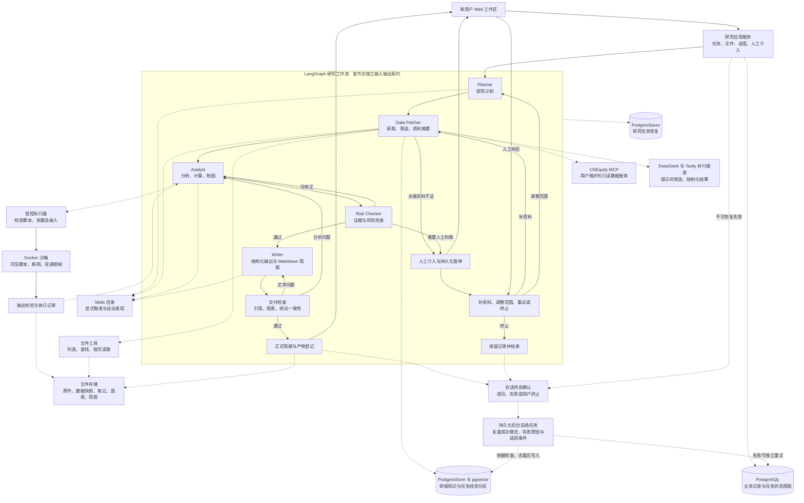

# Research Copilot 复现与升级规格

版本：讨论汇总稿 v1.1  
日期：2026-10-22  
状态：需求已按对话归纳；详细接口、实施计划和测试边界待审阅；尚未开始业务实现。

本文区分三类内容：**已确认需求**是用户已确定的产品与架构边界；**设计草案**是为使需求可落地而提出的接口、数据模型和测试组织；**待定项**不作为已经完成的决策或验收结果。编写本文不代表授权开始大规模编码、执行付费调用或发布到外部。

## 问题陈述

用户希望输入一个 A 股个股或行业研究问题，即可获得有依据、带引用及可视化图表的投研简报。现有参考项目提供多 Agent 研究流程的演示，但不足以支持真实数据获取、上传研报处理、跨任务知识积累、可靠人工介入以及图表和文件交付。

用户需要保留清晰的工作流控制，在研究阶段内允许 Agent 按需使用技能和数据工具；同时避免失败被 mock 掩盖、过期资料被当作最新事实、计算产物不可复现，以及研究中断后只能从头开始的问题。

## 解决方案

先复现参考项目并记录可运行基线，再在 LangGraph 基础上升级。首版面向单用户，Windows 开发、Linux 部署，提供 Web 研究工作区。

以 Data Fetcher 替换 Retriever 和原项目 RAG 链路：主要通过用户维护的 CNEquity MCP 获取结构化数据；需要网页资料时并行调用 DeepSeek 与 Tavily；使用文件工具读取上传的研报和笔记。Data Fetcher 根据提示词筛选内容，输出符合契约的证据集合，并沉淀可追溯的研报摘要与观点。

Skills 提供按需加载的指令、模板及可信脚本。脚本在受限 Docker 容器内执行。PostgreSQL 保存业务数据、工作流 checkpoint 和长期记忆；pgvector 索引研报摘要与观点；新增会话结束后的后台任务经验总结，经验与研报知识分开管理。简报采用 Markdown，正文嵌入图表，文件独立归档。

### 架构图

实线表示主流程、条件路由或人工恢复；虚线表示能力调用与存储依赖。图中 Agent 输入输出均经过契约边界，基础设施细节属于设计草案。

### 用户可见结果

- 正常任务自动推进，不默认要求用户审批研究计划。
- 资料不足或风险检查要求人工判断时，用户可补资料、调整范围或终止。
- 用户可以查看研究阶段、数据来源、技能使用、执行结果及失败原因。
- 简报包含核心结论、依据与分析、风险与不确定性、来源；图表根据研究问题需要生成。
- 首批验收覆盖个股财务分析及行业三家公司对比，具体标的、研究截止日期和报告期依数据覆盖确定。

## 用户故事

1. 作为研究用户，我希望输入 A 股个股研究问题，以便获得针对性的投研简报。
2. 作为研究用户，我希望提出行业对比问题，以便比较代表公司的经营表现与风险。
3. 作为研究用户，我希望明确研究截止日期，以便理解结论所依据的信息范围。
4. 作为研究用户，我希望查看自动生成的研究计划，以便理解系统正在研究什么。
5. 作为研究用户，我希望正常研究无需逐阶段批准，以便减少重复操作。
6. 作为研究用户，我希望上传可提取文字的研报 PDF，以便将已有资料用于分析。
7. 作为研究用户，我希望上传调研笔记及研究数据，以便结合自己的资料提出问题。
8. 作为研究用户，我希望原始资料可跨任务复用，以便避免重复上传。
9. 作为研究用户，我希望看到扫描件或解析失败的明确提示，以便补充可用材料。
10. 作为研究用户，我希望引用能定位原文页码或数据记录，以便核对关键结论。
11. 作为研究用户，我希望通过 CNEquity 获取结构化数据，以便使用自己维护的数据服务。
12. 作为研究用户，我希望系统识别数据覆盖和时效缺口，以便避免基于缺失数据作判断。
13. 作为研究用户，我希望系统并行搜索 DeepSeek 与 Tavily，以便获取互补的公开资料。
14. 作为研究用户，我希望 Agent 筛选重复、无关和不适用资料，以便减少研究噪声。
15. 作为研究用户，我希望相反观点得到保留，以便理解市场分歧。
16. 作为研究用户，我希望单路搜索失败时得到明确提示，以便知道研究范围是否受影响。
17. 作为研究用户，我希望关键证据不足时暂停询问，以便决定是否补资料或缩小范围。
18. 作为研究用户，我希望显式指定技能，以便采用预期的研究方法。
19. 作为研究用户，我希望系统自动发现补充技能，以便覆盖研究所需步骤。
20. 作为研究用户，我希望技能不能绕过风险检查，以便维持一致的研究质量要求。
21. 作为研究用户，我希望可信脚本完成计算和制图，以便获得可复核的结果。
22. 作为研究用户，我希望脚本运行相互隔离，以便一次失败不影响其他任务或原始资料。
23. 作为研究用户，我希望查看计算输入、参数和执行结果，以便复核图表及数值。
24. 作为研究用户，我希望失败执行保留日志，以便查明问题而不丢失证据。
25. 作为研究用户，我希望研报摘要与观点在 Data Fetcher 阶段沉淀，以便后续研究复用知识。
26. 作为研究用户，我希望记忆保留原报告来源和日期，以便区分历史观点与当前事实。
27. 作为研究用户，我希望同一报告版本不会重复入库，以便保持记忆清晰。
28. 作为研究用户，我希望能够停用错误记忆，以便避免它影响未来任务。
29. 作为研究用户，我希望按标的、日期及语义查找相关观点，以便发现此前积累的材料。
30. 作为研究用户，我希望人工介入后继续原任务，以便复用已完成的工作。
31. 作为研究用户，我希望服务重启后仍可恢复任务，以便处理跨天研究。
32. 作为研究用户，我希望补充资料后重新检查受影响分析，以便避免使用过时结论。
33. 作为研究用户，我希望在简报中直接阅读图表，以便快速理解关键比较。
34. 作为研究用户，我希望单独查看和下载研究产物，以便继续使用计算数据、图表及简报。
35. 作为研究用户，我希望最终简报通过引用和图表检查，以便减少交付错误。
36. 作为研究用户，我希望任务列表和阶段进度持续可见，以便知道当前状态。
37. 作为研究用户，我希望通过独立页面管理长期记忆和 Skills，以便查看可复用能力。
38. 作为研究用户，我希望调用或预算失败被如实报告，以便自主决定是否继续投入。
39. 作为研究用户，我希望分别配置研究模型、Embedding 和搜索服务，以便更换服务而不改变研究流程。
40. 作为项目维护者，我希望先建立参考项目基线，以便证明升级带来的行为变化。
41. 作为项目维护者，我希望所有 Agent 使用标准输入输出契约，以便独立验证、演进及定位失败。
42. 作为项目维护者，我希望区分离线验证与真实服务验收，以便准确判断交付质量。
43. 作为项目维护者，我希望在 Windows 开发、Linux 部署，以便保持开发便利与部署一致性。

44. 作为研究用户，我希望任务会话结束后自动在后台总结成功经验和失败教训，以便后续研究少走弯路。
45. 作为研究用户，我希望经验记录保留任务来源、证据和适用边界，以便避免过度推广偶然结果。
46. 作为研究用户，我希望总结失败不影响已交付简报，并能独立重试，以便保留研究成果。
47. 作为研究用户，我希望研报知识和任务经验分开管理，以便区分金融观点与执行方法。

## 实施决策

### 1. 参考基线与升级边界

**已确认需求：**先基线、后升级；外层保留 LangGraph 工作流控制，不将流程交给完全自主的总控 Agent。目前按 LangGraph、Store 与自建文件/技能能力编制规格，未将 DeepAgents 加入依赖；对长期记忆的讨论不等于重新授权引入该框架。

参考项目静态核查显示：

- 有 Planner、Retriever、Analyst、Risk Checker、Writer 与人工审核，以及修订分支。
- 输入资料为演示 Markdown，使用哈希向量；完整 Markdown 报告保存在状态及返回结果中，trace 中的报告片段不等于完整归档。
- 缺少 Key 或真实模型异常可降级为 mock；LangGraph 异常存在切换 native 执行的行为。
- 人工审核采用同步输入，非交互环境可自动通过；内存 checkpoint 不构成跨进程恢复。
- 节点共用 ResearchState，通过提示词要求 JSON 并作手工校验。不存在每 Agent 独立输入输出 JSON Schema 强校验；工具入参 Schema 与 Agent 契约不能混同。

以上为公开源码核查，尚未在本项目完成运行复现。基线应记录这些真实行为，不以改变原项目来制造成功结果；升级版显式移除隐式成功降级。

### 2. 工作流职责与恢复

| 阶段 | 职责 | 主要出口 |
|---|---|---|
| Planner | 理解问题、范围、截止日期，形成计划与数据需求 | Data Fetcher |
| Data Fetcher | 获取资料、提示词筛选、标注缺口、提炼及召回记忆 | Analyst；关键缺口转人工 |
| Analyst | 组织分析，调用可信计算和制图技能，关联证据 | Risk Checker；需要补数时回 Data Fetcher |
| Risk Checker | 检查证据支撑、分析风险和缺口 | 通过到 Writer；修订到 Analyst；必要时人工 |
| Writer | 将已审核分析组织为图文简报 | 交付检查 |
| 交付检查 | 检查引用、图表和结论一致性 | 通过交付；文字修订回 Writer；分析修订回 Analyst |
| 人工介入 | 展示原因并接收补资料、范围调整、重试或终止 | 恢复相应阶段或结束 |

节点路由细节为设计草案：Agent 输出路由建议，编排层校验后决定下一步；修订与补数受预算约束。人工确认不得将缺失证据变成已验证事实。补资料后使受影响分析、风险检查和简报版本失效，重新计算相关结果。

恢复不仅包括重载 checkpoint，也包括识别已完成外部操作：记忆写入、脚本执行、产物登记必须有幂等标识；不能假定重放节点不会再次执行副作用。具体幂等键与事务方式在详细设计中确定。

### 3. Agent 标准输入输出契约

**已确认需求：**每个 Agent 均定义标准输入和输出 JSON Schema。模型是否支持服务端严格 Schema 尚待选型，应用侧必须校验，不能以 JSON mode 替代完整验证。

下表为逻辑字段草案，不是已冻结的 Schema；最终字段类型、必填性、枚举和版本策略在实现前评审。

| 契约 | 输入逻辑字段 | 输出逻辑字段 |
|---|---|---|
| Planner | 研究问题、截止日期、范围约束、附件摘要、显式技能 | 研究范围、任务清单、数据需求、技能计划 |
| Data Fetcher | 计划、数据需求、资料标识、可用工具、预算与补数要求 | 证据集合、资料定位、结构化数据引用、缺口、各服务状态、筛选说明、记忆标识 |
| Analyst | 分析任务、证据集合、技能、既有执行及修订要求 | 分析结论、证据关联、计算结果引用、图表引用、假设与不确定性、补数请求 |
| Risk Checker | 研究范围、分析结果、证据、缺口、执行记录 | 通过/修订/人工建议、问题清单、问题依据、修订要求 |
| Writer | 已审核分析、引用清单、图表标识、简报要求 | Markdown 正文、引用清单、图表关联、适用日期与限制 |
| 交付检查 | 简报、已审核分析、资料及产物清单 | 检查结果、问题与定位、修订目标 |

契约设计原则：

- 输入从全图状态中显式组装；输出校验通过后才写入对应节点负责的状态字段。
- 大文件和二进制内容通过稳定标识引用，不将全文或文件字节在所有 Agent 之间重复传递。
- Writer 的最终输出也是 JSON，Markdown 正文作为其中的字段承载。
- 程序验证结构、字段类型及引用存在性；提示词指导内容判断。Schema 合法不代表证据真实或推理正确。
- 未通过校验的输出不能推动正常阶段或登记正式产物。是否允许一次有界格式修复留待实现方案确定，任何失败均需可见且计入预算。
- 新增交付检查不预先规定必须再建一个自主 Agent；确定性检查与必要的模型一致性检查组合方式待详细设计。

### 4. 数据入口与搜索筛选

**CNEquity：**由用户部署、初始化和更新，本项目只连接既有 MCP。默认查询本地湖，不让研究任务启动全量采集。需要记录查询参数、研究截止日期、结果来源、实际覆盖、截断及缺失状态。

静态核查的接入约束：其 MCP 包含数据湖描述、证券解析、行情、财报、数据集和 SQL 查询，不包含通用网页搜索；公告索引不等于公告正文，研报列表不等于 PDF 下载解析。财报的历史可见性模式和逐行来源暴露存在接口差异，需按部署版本核实，不能仅凭返回成功就宣称满足证据追溯。

**网页搜索：**DeepSeek 与 Tavily 并行调用，汇总后由 Data Fetcher 根据提示词判断内容，最终输出标准结构化结果。不建立一套独立的硬编码语义评分流水线。

提示词应明确：

- 识别同 URL、相同正文和转载关系，说明合并原因并保留来源关系。
- 判断与研究问题、标的、研究截止日期的匹配程度及正文可用性。
- 优先原始披露和一手资料，再考虑相关性、时效；不能直接比较不同服务的原始分数。
- 保留相反观点，不将同一材料的转载视为独立佐证。
- 搜索摘要未核对原文时标为线索，不成为关键结论的唯一依据。

程序负责结构校验、资料标识关联、服务状态与预算记录，不以提示词替代权限和执行边界。

**失败例外：**一路搜索失败时明确显示失败来源；若成功结果足以支撑关键需求则可继续，否则升级人工。两路均失败则暂停。此规则是用户确认的通用失败暂停规则的例外，不允许静默报告双路成功。

### 5. 文件与研究产物

- 原始资料跨任务复用，研究笔记、计算结果、图表和简报按任务及版本归档。
- PDF 首版仅处理可提取文本的文件，保留原件及页码映射；扫描件、表格解析失败或正文不完整需要明确标注。
- 文件工具提供列表、关键词查找、按页或范围读取；首版不建设整份 PDF 全量向量切块检索。
- 原始资料只读；输出在本次执行隔离目录生成，经校验后登记正式产物。
- 图表独立保存，并由简报引用可解析的资源地址；不能以某台开发机的绝对路径作为交付引用。
- 同一文件或资料快照通过内容哈希和来源元数据识别版本；只保存 URL 不足以复核后续变化。
- 首版不自动清理原件、旧版本和失败证据。保留期限、删除和备份策略尚未讨论，不能由实现自行引入不可逆清理。

### 6. 长期研究记忆

**已确认需求：**Data Fetcher 阶段提炼研报摘要和核心观点，经来源、页码及原文一致性检查后进入跨任务召回。相同文档版本去重；不同机构的冲突观点并存；用户可停用错误记忆。

记忆代表“某来源在某日期提出的观点”，不自动代表系统认可的当前事实。整份最终简报不自动沉淀为长期事实。后续引用回到原始资料，记忆不能成为与原报告重复计算的独立证据。

使用 PostgresStore 持久化记忆，pgvector 仅索引摘要与观点；检索结合标的、日期、有效状态及语义召回。原件继续保存在文件存储中。记忆候选记录可包含资料标识和版本、股票/行业、发布日期、摘要、观点及页码、状态、来源任务、提取与 embedding 版本。

具体过期策略和索引重建机制为待定项：不能将一个统一 TTL 当作所有金融知识的有效期；历史观点可以保留，但不应在当前研究中冒充当前结论。更换 embedding 模型时需明确维度及重建范围。

### 6.1 会话结束后的后台经验总结

**新增已确认需求：**一次任务会话结束后，在后台总结本次成功/失败历史经验，写入长期记忆。独立资料库页面与全局资料管理入口移除；附件仍从研究对话提交，并在任务内查看证据。不删除已有原始文件、研究证据或后台资料引用结构。

以下执行语义为设计草案，原型仅做状态演示：

- 以持久化的会话终态事件触发后台总结：成功结束、最终失败、用户明确终止。等待人工、可恢复暂停、浏览器关闭及单次工具报错不等于会话结束。
- 成功依据来自交付检查，失败依据来自实际执行结果；用户选择的演示结果不作为正式系统的成功证据。失败会话中可以有有效做法，成功会话中也可以有应避免的问题。
- 总结在研究主流程之外执行，不阻塞交付；从会话快照读取问题、计划、工具和技能执行结果、人工修正、检查结果、错误与产物引用。大文件使用标识及必要片段，不整份复制。
- 后台任务持久化排队，记录待处理、处理中、完成、失败；建议以会话标识及结束版本作为幂等键，避免恢复或重复结束产生重复记忆。
- 输出标准结构化记录：来源会话、结果分类、经验描述、具体依据、原因置信度或未知标记、建议动作、适用条件、不适用边界、版本和有效状态。
- 未经依据检查的候选不进入正常召回；不得臆造失败根因，不把临时服务错误记成永久能力缺失，不把成功运行等同于财务结论正确。
- 总结失败单独记录，可独立重试，不改写原任务结果、不重新执行研究、不反复自动消耗预算。重试需遵循已配置的预算与调用授权。
- 研报知识与任务经验通过不同类型及 namespace 隔离；金融引用仍来自原始证据，经验仅指导规划、数据获取和分析方法，不作为金融事实的依据。
- 后续任务按研究场景、技能、错误类型及适用条件召回经验；是否对经验额外建立向量索引、具体检索字段及注入节点在详细设计中确认。
- 用户可查看依据并停用经验。系统不因一次总结自动修改技能脚本、权限或审核规则。
- “结束会话”的最终交互与完成后是否自动关闭会话，仍需详细设计；原型提供显式结束按钮来演示该边界。

### 7. Skills 与执行隔离

- Skills 支持指令、模板及可选脚本，按需加载；用户可显式触发，系统可自动发现并补充相关技能。
- 技能加载、脚本执行、工作流路由是不同职责。加载技能不授予额外文件、网络或审核权限。
- 首版仅运行项目维护的可信脚本，不运行上传的外部脚本或模型临时生成代码。
- 执行器接收可信脚本标识、结构化参数、输入文件标识；Agent 不控制 Docker 命令、镜像来源或宿主挂载。
- Docker 按次隔离、默认断网，原始输入只读，输出与临时目录可写；固定依赖，限制 CPU、内存、进程数、时间及输出规模。
- 非特权、非 root 执行，不向计算容器注入应用密钥、数据库凭证或 Docker socket。
- 执行器记录脚本与镜像版本、输入哈希、参数、退出状态、日志及输出标识。失败保留证据，不登记半成品为有效结果。
- 沙箱计算由应用提供数据快照；联网获取资料仍由 Data Fetcher 的受控工具完成。

### 8. 存储与业务模型

**已确认选型：**PostgreSQL + pgvector；任务恢复使用 PostgreSQL-backed checkpointer，跨任务记忆使用持久 Store。框架表由对应版本的迁移和 setup 管理，不手工改造内部结构。

以下业务实体与表名为设计草案，尚未冻结物理 Schema：

| 实体/候选表 | 核心信息 | 关联及责任 |
|---|---|---|
| 研究任务 / research_tasks | 问题、范围、截止日期、状态、thread 标识 | Web 查询入口；恢复依据仍为 checkpoint |
| 原始资料 / documents | 来源、标题、发布日期、哈希、原件和解析位置、解析状态 | 跨任务复用；资料版本可定位 |
| 任务资料 / task_sources | 任务、资料版本、用途 | 记录本次任务实际采用的资料 |
| 研究产物 / artifacts | 任务、类型、位置、版本、生成执行 | 图表、数据、笔记及简报归档 |
| 人工介入 / review_requests | 任务、暂停标识、原因、响应、处理状态 | 与可恢复工作流关联 |
| 执行记录 / executions | 脚本及镜像版本、输入、参数、状态、日志 | 关联一个或多个产物 |
| 后台总结 / reflection_jobs | 会话标识与结束版本、快照引用、状态、尝试次数、错误、记忆标识 | 持久化排队与幂等总结，表名为设计草案 |

长期记忆正文使用 Store 的结构化 value 保存，不另建一份重复的摘要权威表。文件字节不塞入每个 checkpoint；图状态主要保存业务结果和引用。任务状态视图与 checkpoint 的一致性、Store 与资料引用的校验及幂等写入机制需在详细设计中明确。

### 9. Web 交互与应用接口

已确认布局：左侧任务列表和新建入口；中间研究问题、阶段进度、人工介入、图文简报；右侧本次资料、引用定位和研究产物；独立管理页仅展示长期记忆和 Skills，独立资料库功能已取消。附件上传及证据定位留在任务内。

原型评审补充：用户已选择 B「简报阅读台」的视觉风格，采用灰蓝编辑台、衬线报告标题和旁注证据。新建研究采用 Agent 式对话入口，在同一个消息输入区完成研究问题输入、技能选择和附件添加；发送后呈现研究对话与进度。该确认不代表原型中的固定演示回复或未实现的服务已成为真实产品能力。

应用服务需要提供以下能力，具体 URL、HTTP 方法和事件传输协议留待接口设计：

- 创建、查询研究任务，获取阶段进度、失败原因和产物。
- 在任务会话中上传、列出、读取附件及证据定位信息；不提供独立全局资料库页面。
- 查询待处理人工介入，提交响应并恢复或终止任务。
- 获取简报、图表及其他产物，查看执行结果和技能使用。
- 按研报知识/任务经验查询及停用长期记忆，查看可用技能。
- 结束任务会话，查询后台总结状态、依据与结果，按授权单独重试失败总结。

单用户不等于可无保护公开暴露。首版面向单用户部署，公网暴露与认证方式尚未确定；不将研究上传目录或执行器控制接口直接作为公开静态资源。

### 10. 运行配置与失败语义

- Windows 开发，Linux 部署；Docker Compose 管理应用与 PostgreSQL，独立执行器管理计算容器；CNEquity 外置。
- 研究模型、Embedding、网页搜索独立配置。研究模型及 Embedding 暂待选型，不阻塞规格与架构设计。
- 调用次数、运行时间、修订轮数设置可配置上限；具体默认值及付费预算待实施方案确认。
- 除已明确的单路搜索例外，调用失败或预算耗尽显式暂停或失败；保留产物，不静默切 mock、不整条流程自动重跑。
- 取消、重试和恢复须有明确任务及执行身份，避免重复提交造成多次计费或重复产物。
- 真实模型、Embedding、搜索服务及 CNEquity 的联调结果分别记录，离线通过不能替代真实验收。

## 测试决策

### 测试边界提案

优先使用一个最高层业务边界：**研究应用服务的提交、查询、人工响应、恢复与交付接口**。通过这一边界验证用户可见行为，避免为每个内部函数增加与实现一一对应的测试。

测试边界是本规格的审阅项，尚未单独确认；本次按“不再访谈、先整理文档”的要求先写入提案。现有本地项目仅有环境与讨论文档，无可直接沿用的本地测试。参考项目的离线流程、工具约束和 replay 思路可作为先例，但必须先基线复现后才能判断可复用程度。

补充边界仅用于业务接口难以证明的事项：Agent 契约、外部数据适配器、沙箱执行器。测试关注可观察的拒绝、隔离、状态变化和输出，不锁死内部函数调用次序。

### 验收矩阵

| 编号 | 场景 | 可观察的通过标准 |
|---|---|---|
| T01 | 原项目基线 | 固定参考版本，记录依赖、执行入口、测试结果、实际引擎与 mock/真实模式；降级如实显示 |
| T02 | 个股研究 | 简报回答增长驱动、利润与现金流匹配问题，关键结论有来源与必要图表 |
| T03 | 行业对比 | 三家公司比较口径、时期、单位清晰；差异与风险可追溯 |
| T04 | 上传 PDF | 原件、提取文本及页码可关联；扫描件和解析缺口明确可见 |
| T05 | 双路搜索 | 两路并行被实际记录，筛选输出满足契约，保留来源及过滤原因 |
| T06 | 搜索部分失败 | 单路失败可见，充分证据可继续；不足转人工；双路失败暂停 |
| T07 | Agent 契约 | 缺字段、错误类型或不存在的引用不能进入正常下游或正式交付 |
| T08 | 风险与人工 | 可修正问题回分析，人工请求可响应；人工批准不消除证据缺口 |
| T09 | 跨进程恢复 | 暂停后重启应用，补资料能恢复原任务；受影响分析与风险检查重新执行 |
| T10 | 副作用幂等 | 重放不会重复登记同版记忆、有效产物或已确认完成的执行 |
| T11 | Skills | 显式技能可加载，自动补充可追踪；技能不能改变审核与执行边界 |
| T12 | 沙箱 | 可信脚本可产出图表；输入不可修改、网络不可用、资源超限被终止，失败证据保留 |
| T13 | 记忆准入 | 来源或页码缺失、不一致摘要不进入正常召回；同版去重、冲突观点并存 |
| T14 | 记忆检索 | 标的/日期过滤与语义召回有效，停用记忆不被新任务召回，引用回到原件 |
| T15 | 交付检查 | 缺图、错引用、分析不一致能够阻止交付并路由到对应修订阶段 |
| T16 | 预算与失败 | 达到上限显式停止，保留已有产物；不 mock、不隐式整流程重跑 |
| T17 | Web 工作区 | 实际入口可完成提问、上传、介入、阅读及下载；三栏与管理页按原型验收 |
| T18 | Linux 部署 | 重启后数据库和文件仍可用，应用可连接外置 MCP，沙箱按约束工作 |
| T19 | 后台经验总结 | 终态触发一次总结，临时暂停不触发；成功/失败依据可定位，结果不混入金融事实 |
| T20 | 总结故障与幂等 | 总结失败不影响已有简报；后台重启可恢复，重复事件不重复入库；独立重试不重跑研究 |
| T21 | 取消资料库 | 导航和独立页面均无资料库入口，任务附件上传及证据读取仍可用 |

### 证据等级

1. 离线契约和流程测试：可替换外部响应，结果只证明应用行为。
2. 基础设施集成：使用真实 PostgreSQL、pgvector、文件存储和 Docker，验证持久化、检索及隔离。
3. 外部服务契约验收：使用用户实际 MCP 和选定模型、Embedding、搜索服务；记录覆盖、费用、失败及降级，不以 HTTP 200 代替结果正确。
4. 完整用户流程：通过 Web 完成两类研究场景，检查正文、引用、图表、人工恢复及原始证据。

真实付费执行需在服务、模型及预算确定后获得明确授权。跳过、mock、缓存回放和降级结果单独标注，不作为真实链路通过。

## 不在范围内

- 多用户、团队权限和组织级协作。
- 独立资料库页面、全局资料浏览与独立上传入口；任务内附件和证据保留。
- 港股、美股及未定义的全市场研究场景。
- 扫描 PDF 的 OCR 与保证所有复杂表格自动正确解析。
- 整份 PDF 的全量向量切块检索和原项目 RAG 链路的保留升级。
- 任意外部技能脚本、模型生成代码执行、动态自由安装依赖。
- 自动交易、订单执行；评级、目标价和买卖建议不作为首版强制交付项。
- 简报 PDF 导出；首版交付 Markdown 与图表文件。
- 自动将最终简报结论当作长期事实，或把历史预测当作当前事实。
- CNEquity 数据湖的部署、采集、初始化及日常维护。
- 由本规格直接授权付费执行、外部发布或业务代码实现。

## 补充说明

### 待定项与进入实施的条件

| 待定项 | 处理时点 |
|---|---|
| 研究模型、Embedding、API 地址及调用预算 | 真实接入验收前确定 |
| CNEquity 部署版本、连接信息、实际数据覆盖与溯源缺口 | 数据适配器实施及实测前核实 |
| 参考项目固定提交、依赖版本与可复用测试 | 基线阶段确定 |
| 各 Agent 完整 JSON Schema、版本和格式错误处理 | 契约实现前评审 |
| 物理表结构、状态映射、幂等与文件提交方式 | 持久化实施前评审 |
| 预算默认值、修订与补数上限、沙箱资源上限 | 实施方案评审 |
| 记忆时效过滤、embedding 版本与重建策略 | 记忆模块实施前评审 |
| 会话终态判定、后台总结预算、经验 Schema 与检索策略 | 后台经验总结模块实施前评审 |
| 首批技能的准确清单、标的、日期和数据口径 | 场景验收准备时确定 |
| 前后端技术栈、事件协议、视觉原型、部署访问保护 | Web 与部署实施前确定 |
| 测试边界提案 | 规格/实施方案审阅时确认 |

### 建议交付阶段（未授权实施）

1. 基线复现：固定原项目版本，记录运行、测试和降级边界。
2. 契约与持久化：Agent 契约、任务状态、资料与产物模型、人工恢复。
3. 数据与记忆：CNEquity、双路搜索、PDF 文件工具、摘要记忆及 pgvector。
4. 技能与计算：按需技能加载、可信脚本沙箱、图表及执行追溯。
5. 简报与 Web：Writer、交付检查、工作区及管理页、原型核对。
6. 分层验收：离线、真实基础设施、授权外部调用、完整 Web 研究场景。

后续实施方案需明确每阶段模块/文件范围、验收门槛和风险；用户确认后才开始对应大规模代码改动。

### 参考依据

- [参考投研多 Agent 项目](https://github.com/LUOCHENGQING/my-projects/tree/main/fin-research-multi-agent)：基线流程与当前实现的静态核查依据。
- [CNEquity](https://github.com/rootSunc/CNEquity)：结构化金融数据服务及部署边界。
- [CNEquity MCP 说明](https://github.com/rootSunc/CNEquity/blob/main/docs/zh/reference/mcp.md)：MCP 能力与只读查询边界。
- [LangGraph 记忆与持久化](https://docs.langchain.com/oss/python/langgraph/add-memory)：checkpointer、Store 与语义检索能力。
- [DeepSeek Search 与 Fetch](https://api-docs.deepseek.com/guides/search/)：搜索和正文抓取接口。
- [Tavily Search](https://docs.tavily.com/documentation/api-reference/endpoint/search)：并行搜索入口。
- [Docker 安全](https://docs.docker.com/engine/security/)与[资源约束](https://docs.docker.com/engine/containers/resource_constraints/)：沙箱隔离设计参考。

引用为设计讨论期间核查的公开文档和源码，不代表已经完成本地或生产验收。实施时应固定版本并验证接口。

